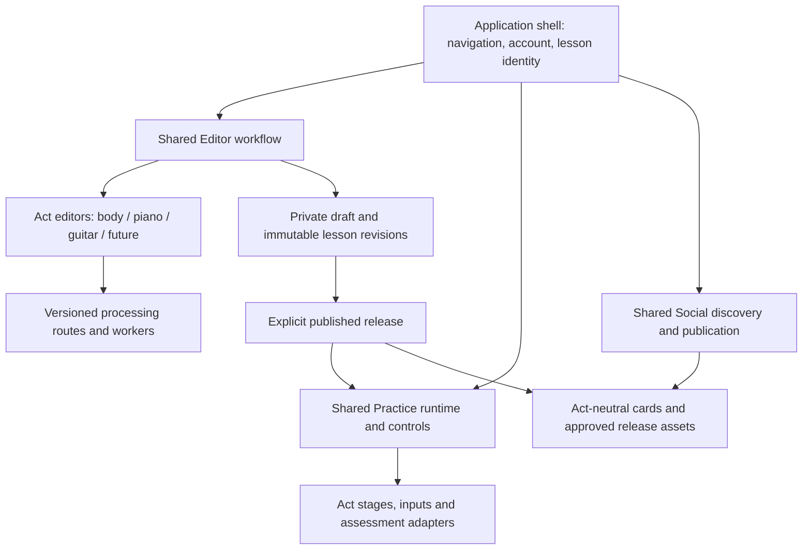

# Act Platform: Phased Implementation Plan

Status: proposed implementation plan; no application changes made by this document.

Prepared: 19 November 2026.

## 1. Product architecture and intended result

The application has three shared product engines:

1. **Editor:** create a lesson, prepare/upload source material, run processing, review and correct the result, save a private revision, and publish a selected release.
2. **Practice:** watch, rehearse, repeat sections, complete challenges, resume progress, and optionally receive feedback.
3. **Social:** discover published lessons through feeds, search and recommendations, open them, react to them, and manage access/reporting.

**Acts** provide the specialized experience inside each engine. Initial Acts are full body, piano, and guitar. Future Acts include singing, acting, and drawing.

The shared framework owns the journey, common controls, lifecycle rules, identity, permissions, and integration contracts. Each Act owns its editor tools, specialized layouts, reference validation, practice stages, inputs, and assessment. Full body never uses a piano note editor. Piano and guitar can reuse musical modules where their requirements overlap.

AI pipelines are implementations used by an Act. SAM, MediaPipe, transcription models, and future models are not additional product engines. An Act can select among several processing pipelines without changing its identity or the surrounding product journey.

### Architectural direction

Keep the existing web application, API, database, and independently running processing workers. Establish clear module boundaries within them. This plan does not require microservices, a new framework, or a rewrite.

### Expected user experience

* Users recognize the same create/review/save/publish sequence across Acts, even when an Act has additional processing or review steps.
* A note editor, movement editor, and drawing editor have different tools and may have different stage layouts.
* Common actions have consistent names, placement, disabled reasons, save status, and navigation behavior.
* Every enabled Act has an integration path through Editor, Practice, and Social. Features can be unavailable for a particular lesson/device, with an explicit reason.
* Publishing means releasing an exact reviewed revision. Saving privately does not silently update what recipients see.

## 2. Vocabulary and invariants

| Term | Meaning | Example |
| --- | --- | --- |
| Act | Product experience and its extension points | full_body, piano, guitar |
| Subject | Search/browse classification within an Act | dance, taekwondo, boxing |
| Lesson | Authored teachable item with a stable identity | A specific piano passage or movement tutorial |
| Source performance | Original demonstration captured in uploaded media | Instructor video/audio |
| Processing job | One versioned attempt to derive editable references | MediaPipe or piano transcription job |
| Draft | Mutable private working material and correction state | Edited pose/reference or score |
| Revision | Immutable saved lesson/reference snapshot | Revision 7 |
| Release | Exact revision made available to an audience | Revision 5 remains public while revision 7 is private |
| Practice attempt | One learner rehearsal/challenge execution | An interrupted or completed run |
| Assessment | Act-specific analysis of learner evidence | Pose similarity, note timing, future stroke comparison |
| Feedback | Information shown to the learner | Live cue, delayed report, final result |

The existing music notation `performance` array retains its technical meaning. Do not rename or migrate it merely to introduce this product vocabulary.

### Non-negotiable invariants

* Existing lessons, accepted references, asset hashes, releases, invitations, and revisions remain readable throughout migration.
* No stored revision is rewritten to fit a new frontend abstraction.
* Common screens do not infer product capability from `schema_version`, the presence of a GLB, or worker availability.
* Schema versions describe format compatibility; Acts describe product experience; model versions describe processing provenance.
* Each active practice session has exactly one authoritative transport/clock. Additional capture clocks must map to it explicitly.
* Unavailable assessment produces an unassessed state and reason, never an invented score or failure grade.
* Public assets are deliberately selected and authorized. Private source media does not become public as a side effect of supporting a new Act.
* Shared core modules do not import Act-specific editor tools or AI runtimes.
* Common workflows permit Act-specific steps; they do not require every Act to have the same number of screens.

## 3. Current baseline to preserve

The current working tree includes substantial in-progress MediaPipe, feedback, music assessment, and editor work. Begin implementation from an inventoried baseline; do not reset, overwrite, or assume those changes are absent.

| Existing foundation | Preserve and extend |
| --- | --- |
| `packages/learning-engine/practice-runtime.ts` | Common session state machine |
| `practice-plan.ts` and `practice-transport.ts` | Normalized units, identity, and one clock |
| `practice-session.ts` | Forwarding compatibility facade; not a second runtime |
| `apps/web/src/practice/` | Common controls, settings, voice, fullscreen, and persistence interfaces |
| `packages/lesson-schema/` | Validated legacy body/music payloads and lightweight summaries |
| `apps/api/processing_routes.py` | Versioned routes, outputs, worker capability and availability |
| Lesson/revision/acceptance/publication records | Private edits separated from released revisions |
| `apps/api/permissions.py` | Central access and accepted-release checks |
| Dedicated music practice composition | No correction/undo state constructed during practice |

Important current gaps: body/music dispatch is scattered; Editor orchestration is not shared; music and video-only body cannot be publicly listed; feed/Studio labels lag capabilities; music progress is local-first; public discovery is largely chronological; Act identity is mixed with family/instrument/subject.

## 4. Phase sequence

| Phase | Outcome | Dependency |
| --- | --- | --- |
| 0 | Baseline, behavior inventory, measurements, compatibility fixtures | First |
| 1 | Act identity, descriptors, and capability policy | Phase 0 |
| 2 | Neutral lesson loading and application routing | Phase 1 |
| 3 | Shared Editor lifecycle with specialized Act editors | Phases 1–2 |
| 4 | Complete shared Practice integration and feedback policy | Phases 1–2; coordinate revision handoff with Phase 3 |
| 5 | Act-neutral publication and delivery | Phase 3 plus capability contracts |
| 6 | Shared Social discovery across Acts | Phase 5 |
| 7 | Measured performance improvements and legacy cleanup | Baseline from Phase 0; finalize after Phases 2–6 |
| 8 | Prove a new Act can integrate cleanly | Phases 3–6 |
| 9 | Incremental rollout and final acceptance | Gates from all preceding phases |

Phases 3 and 4 may proceed independently once their contracts stabilize. Performance measurement begins in Phase 0; fix a demonstrated regression in the phase that causes it rather than waiting for Phase 7. Each phase should be broken into reviewable changes that leave the app runnable.

## Phase 0 — Inventory the working app and establish evidence

### Work

1. Record the active source/build versions, migrations, feature flags, processing routes, and outstanding working-tree changes. Identify which MediaPipe/feedback features are already implemented and reuse them.
2. Trace one real lesson journey for each current Act: create, process, review, correct, save, release privately, practice, challenge where supported, and history/resume.
3. Inventory active entry points and retained legacy paths. Distinguish unreachable compatibility code from mounted duplicate controllers.
4. Capture the behavior matrix below using current code and UI observations. Mark missing capabilities explicitly; do not describe future functionality as present.
5. Record baseline route-loading, API, and runtime measurements on named desktop/mobile test configurations. Use prepared lessons for repeatability and keep expensive AI inference outside ordinary UI tests.

### Required baseline matrix

For full-body SAM, full-body MediaPipe, piano, and guitar, record: editor tools, review/save rules, reference format, source playback, practice modes, device inputs, feedback, assessment, challenge policy, progress location, private sharing, public eligibility, and fallback behavior.

### Measurements

* Feed, editor, and practice transferred JavaScript/CSS; code loaded versus components mounted.
* Manifest/reference request counts and bytes when opening a lesson and switching modes.
* Feed/workflow database query counts at small and larger representative library sizes.
* Practice frame responsiveness, React commit cost, memory after repeated Act/mode switches, and release of microphone/camera/audio/worker resources.
* Existing end-to-end and contract test results. Record existing failures separately from new regressions.

### Deliverables and exit criteria

* An architecture map, Act/capability matrix, compatibility fixtures, and reproducible benchmark procedure/results.
* Explicit performance budgets derived from those results and supported devices before restructuring starts. Exact numbers must be recorded, not left as “fast enough.”
* A list of active versus legacy routes and data formats, with the tests protecting each.

## Phase 1 — Introduce Act identity and explicit capabilities

### Work

1. Add stable Act IDs for `full_body`, `piano`, and `guitar`. Reserve future concepts in documentation, but do not advertise unimplemented Acts as supported.
2. Keep existing subject IDs and instrument fields for compatibility. Map dance/taekwondo/boxing/movement_other to full_body, piano to piano, and guitar to guitar. Do not infer classifications from titles or filenames.
3. Make the server authoritative for enabled Act metadata and product policy. Frontend code supplies a statically registered, lazy-loadable implementation for each supported Act; the server never supplies executable module paths.
4. Define versioned, data-only Act descriptors: identity, label, permitted subjects, supported creation inputs, enabled processing routes, editor/review capabilities, practice inputs/modes, assessment adapter versions, and permitted publication representations.
5. Keep processing routes as separate records linked to Acts. Multiple pipelines can implement one Act. Worker online status affects new processing jobs, not unrelated playback/input capabilities of an existing lesson.
6. Resolve effective capabilities from separate layers: Act support, lesson assets/review state, creator policy, learner choice, device readiness, audience permissions, and deployment flags.
7. Replace “non-movement means music” assumptions with explicit mappings. `experience_family` remains a legacy implementation hint during migration, not the complete taxonomy.

### Capability representation

Use a small shared result with support, availability, a stable reason code, and a user-facing explanation. Keep stored learner preferences separate from availability. Inputs may be a set (camera, MIDI, microphone, uploaded recording, pointer/stylus), not one exclusive `live_input` value.

Distinguish `canEdit`, `canReview`, `canPractice`, `canChallenge`, `canAssess`, `canRecord`, and `canPublishPublicly`. They need not all have the same answer.

### Schema and data migration

* Add identity metadata additively to lesson rows and new revision snapshots if required. Derive Act identity for old revisions through a deterministic compatibility adapter; do not mutate their JSON.
* Do not insert new fields into strict legacy manifests without format negotiation. Initially put Act/context metadata in a negotiated outer response/summary version while retaining the original payload.
* Support old summary consumers or negotiate a new summary contract; regenerate Python/TypeScript schemas and compatibility fixtures together.
* Unknown Acts or descriptor versions produce a safe unsupported response, not a fallback to body rendering.

### Primary touchpoints

`apps/api/subjects.py`, `processing_routes.py`, `contracts.py`, `lessons.py`, `database.py`, migrations, `packages/lesson-schema/`, `packages/learning-engine/practice-capabilities.ts`.

### Exit criteria

* Current lessons resolve to the correct Act without changing their reference hashes or releases.
* Capability tests cover absent assets, disabled creator feedback, learner-off preferences, disconnected devices, offline workers, and unsupported Acts.
* One documented policy distinguishes unsupported, temporarily unavailable, and user-disabled functionality.

## Phase 2 — Establish a neutral lesson boundary and application shell

### Work

1. Introduce a validated lesson context containing lesson/revision identity, Act identity, permissions/audience, effective capabilities, and the existing specialized body/music document.
2. Retain specialized discriminated payloads. Do not create a giant manifest with every Act's fields optional.
3. Extend `loadLessonDocument()` into the single loading boundary for library, editor, practice, shared, and public destinations. Audience-aware endpoints can differ, but loading/validation/cache behavior shares one implementation.
4. Cache immutable reference assets by hash and lesson context by identity/revision/audience. Scope private metadata to account/session, invalidate on sign-out or access/release changes, and never reuse an owner's private response for a public view.
5. Pass the loaded context into Act entry points rather than fetching the same manifest again by ID. Revalidate mutable release pointers before opening an active release.
6. Replace body-shaped host props with neutral navigation/session callbacks. An Act adapter constructs its body playback, notation services, or future canvas services internally.
7. Separate route handling, authentication return state, library data, authoring navigation, and practice navigation currently concentrated in `LibraryApp.tsx`.
8. Preserve old links/query parameters through compatibility routing. Put Act dispatch at named editor/practice/watch boundaries; Act-specific code can branch internally where appropriate.
9. Give editor and practice separate lazy entry points. Opening piano/guitar practice must not import the review-editor entry module merely to dispatch to practice.

### Proposed organization (illustrative, not a mandatory mass move)

* `apps/web/src/app/`: shell, navigation, lesson loading/context.
* `apps/web/src/editor/`: shared authoring orchestration and shell.
* `apps/web/src/practice/`: existing shared practice integration.
* `apps/web/src/social/`: discovery, cards, search, release entry.
* `apps/web/src/acts/<act>/`: specialized adapters and surfaces.
* `packages/learning-engine/`: DOM-free session behavior already shared.

Move files only when ownership is clear; preserve temporary re-exports to avoid mixing functional changes with a repository-wide rename.

### Exit criteria

* Direct links, refresh/back navigation, invitations, and dirty-edit guards work for all current Acts.
* Switching between Acts leaves no stale lesson, permissions, editor state, or active input resource.
* Request tracing verifies redundant manifest loads are removed; necessary permission/release revalidation remains.
* Build inspection verifies Editor modules are absent from the Practice entry dependency path where they are not needed.

## Phase 3 — Share the Editor lifecycle, preserve specialized editors

### Shared responsibilities

Create one authoring controller/shell for source selection, upload progress, processing status, retry/cancel, draft identity, dirty/save state, revision conflicts, review completion, and publish handoff.

Model processing status separately from authoring status. A completed AI job is not automatically a reviewed or published lesson. Preserve current worker lease/retry semantics.

Normalize an authoring lifecycle such as: source-selected → uploading → processing → needs-review → editing → saved-private → ready-to-release. Cancellation/failure are explicit. Publication is tracked against a revision, not an irreversible final step that prevents later private edits.

An Act can insert additional steps: music verification, body tracking checks, future transcript alignment or drawing-step annotation. It supplies step readiness and errors through the common workflow contract.

### Specialized responsibilities

| Act | Editor responsibilities retained inside the Act |
| --- | --- |
| Full body | Video/pose presentation, trim, sections, tracking-quality review; future skeletal corrections only when implemented |
| Piano | Notes, notation, hands, velocity/pedal, alignment, musical timing and verification |
| Guitar | Strings/frets, tuning/capo, chords/strums, fingering, notation and alignment |
| Future Acts | Their own tools, data validation, layout and correction operations |

### Work

1. Define an editor adapter contract for load draft, render specialized stage/tools, report dirty/validation state, save with base revision, and complete review. Payloads stay Act-specific; the common engine does not edit arbitrary references generically.
2. Separate workflow state from preview transport, editor selection, command history, and AI verification state. The Act keeps its own undo model where useful.
3. Incrementally split `PianoWorkspaceHarness.tsx` into an instrument review entry, loading/recovery services, save/review orchestration, and specialized tools. Preserve current note identities, undo, recovery, alignment, reference hashes, and conflict handling.
4. Keep piano/guitar reusable musical components, but move instrument decisions into explicit adapters/configuration. Avoid one configuration object containing every possible editor behavior.
5. Adapt MoveCheck/SectionEditor to the common authoring lifecycle without pretending that trim/sections provide skeletal editing.
6. Align common labels and semantics: Saved privately, Unsaved changes, Review required, Publish, Update published version, and Processing failed. Act-specific controls can differ.
7. Have the backend own atomic save/review/release eligibility. Introduce narrow application services around existing endpoints where needed; do not duplicate correctness rules in React.
8. Make editor readiness a validation result that can distinguish playback validity from optional assessment readiness. An Act may support a useful unassessed lesson if its source and teaching material are valid.
9. Return saved revision identity to the shell and invalidate affected context/summary caches. Previewing or practicing a private draft must not change the released revision.

### Primary touchpoints

`CreateLesson.tsx`, `MoveCheck.tsx`, `SectionEditor.tsx`, music review/editor routes, `PianoWorkspaceHarness.tsx`, `apps/api/conversions.py`, `music_review.py`, `music_edit.py`, `workflow.py`, `permissions.py`.

### Exit criteria

* All current Acts follow the same save/review/publish semantics while retaining their specialized tools.
* Reprocessing, unsaved navigation, save failure, conflict/recovery, and changing references preserve correct draft/revision identity.
* Publishing eligibility is enforced server-side with Act-specific validation behind one common lifecycle.
* Existing correction, notation, body timing, and acceptance behavior passes regression checks.

## Phase 4 — Complete the shared Practice framework

### Work

1. Keep `PracticeRuntime`, normalized plans, and transports as the sole common session authority. Do not replace them with a new parallel controller.
2. Adapt body composition to the same shell contracts used by music: common header/actions, mode selector, settings, status, section picker, keyboard/voice, and fullscreen. Keep camera setup, pairing, recording, and body layout as specialized extensions. Visual parity does not require identical stage layouts.
3. Define explicit Act practice adapters: build plan, create transport, render stage, prepare/release inputs, expose assessment support, and contribute specialized settings.
4. Preserve exactly one advancing source clock, including buffering, asynchronous play/seek, countdown/rest, replay, capture alignment, and discontinuities. Test adapters against common runtime behavior.
5. Separate neutral challenge policy from specialized assessment. Common policy owns full-run/section scope, permitted speed/seeking, interruption/completion, and result status. Act assessment owns evidence, timing alignment, dimensions, coverage, and whether a defensible score exists.
6. Introduce a common attempt envelope: attempt/lesson/revision/Act identity, mode, plan/unit, duration, completed/interrupted status, assessment adapter/rubric version, and optional specialized report. Retain body/music report formats and history through adapters; do not equate their scores.
7. Extend the existing practice store contract to a common server progress service for authenticated Acts, with local fallback. Scope local state by account, lesson, revision, and plan. Import local music progress conservatively, never across users or incompatible revisions; preserve guest local progress separately.
8. Decide result timing and input setup through capabilities. An Act may offer live cues, delayed analysis, no automated assessment, or multiple inputs.

### Feedback and challenge policy

Treat these as independent concepts:

* **Mode:** watch, practice, challenge.
* **Assessment:** none, or a named/versioned Act adapter.
* **Feedback presentation:** live, after attempt, hidden, or unavailable.
* **Evidence input:** selected camera/MIDI/microphone/recording/stylus, or none.

Support practice with or without automated assessment. Support an **unassessed challenge** as a structured personal attempt when the Act's rules allow it, without requiring an AI input or fabricating a score. A scored challenge requires an eligible reference, valid evidence, and a qualified scorer.

An assessed challenge can hide live feedback and show results after completion. A learner's “no feedback” choice must explicitly specify whether it hides presentation or disables assessment; do not silently treat those as equivalent. Creator-disabled assessment cannot be re-enabled by a learner preference. During migration, preserve legacy behavior until the new choices are represented honestly in the UI.

### Exit criteria

* The same runtime snapshot produces the same common action labels and progression across Acts.
* Practice and permitted unassessed challenges work without input permission prompts.
* Assessed challenges enforce Act-specific evidence rules and distinguish unassessed/insufficient-evidence from low performance.
* Resume works consistently across supported authenticated devices; local fallback remains functional.
* Switching route/Act/input releases capture devices, audio nodes, subscriptions, animation loops, and assessment workers.

## Phase 5 — Make publication and delivery Act-neutral

### Work

1. Add a common publishability result: exact reviewed revision, requested audience, required validation, allowed public representations, missing requirements, and actionable reasons.
2. Reuse centralized authorization and release services. Replace family/schema-based eligibility branches with Act publication policies; preserve the stricter checks until equivalent new checks pass.
3. Separate release metadata from deliverable representations. Model explicit asset roles such as poster, playable preview, instructor media, reference, and optional interactive data; their availability differs by Act and audience.
4. For each existing Act, define and implement at least one approved playable public representation. Full-body video-only needs an explicitly publishable video derivative; music needs an approved video/audio/interactive representation with the assets required to render it.
5. Keep original/private media private unless deliberately included through the existing rights/audience flow. Generate or select dedicated public derivatives; omit internal reports and sensitive metadata. Do not simply remove the current video-only/music rejection checks.
6. Generalize public asset projection and delivery to the role map, including byte ranges, MIME/hash validation, caching, signed/private access where relevant, and revocation behavior. Interactive references are public only when their policy permits it.
7. Use one sharing/publication UI with Act-specific readiness messages. Preserve invitation, link, group, and public audience semantics; enable each supported audience only after its delivery and authorization checks pass.
8. Publication and update-release are atomic at the metadata boundary: incomplete derivatives cannot become a visible release. A failed preparation retains the prior release. Unlisting or revocation behavior must reflect the documented cache/download limits.

### Primary touchpoints

`apps/api/public.py`, `permissions.py`, `sharing.py`, `groups.py`, `workflow.py`, publication/asset records, `ShareLesson.tsx`, `MusicShareLesson.tsx`, lesson loading and schema adapters.

### Exit criteria

* Full-body SAM, full-body video-only, piano, and guitar can publish and open an approved public representation when their release policy passes.
* Public responses contain only explicitly approved assets; owner/private caches cannot supply additional media.
* An unrelated private edit does not update a public/shared release.
* Invite/link/group/public access, moderation hiding, asset access, and removal are covered by integration tests for each Act.

## Phase 6 — Establish the shared Social engine

### Foundation: complete cross-Act discovery

1. Define a neutral discovery item with lesson/release/Act identity, title, creator identity/display name, subjects/tags, poster, duration or appropriate content summary, effective open/practice actions, and audience information.
2. Replace “music = Preview only” and “body = 3D movement” assumptions in FeedCard, PracticeFeed, Studio, public detail, and related-content surfaces with capabilities and actual representations.
3. Standardize server pagination, ordering, filtering, and deduplication. Search and facets operate before pagination and use released metadata for public content. Keep owned/private search authorized and separate from public indexing.
4. Move feed/search orchestration out of the application root. Feed components do not import specialized editor or assessment code.
5. Open every result through the same lesson context/Act entry boundary. Unsupported modes show honest alternatives rather than opening a body fallback.

### Product additions after the foundation

6. Add an initial explainable recommendation policy: related Act/subject/tags, optionally followed by declared preferences and explicit engagement signals. Start with deterministic ranking and a stable fallback, not an ML recommender. Define cold-start, diversity, and unavailable-content handling.
7. Add likes with authenticated, idempotent like/unlike endpoints, a uniqueness constraint, counts, and moderation/deletion rules. Define whether likes attach to the stable lesson or release; proposed default is lesson identity with the currently visible release required at interaction time.
8. Add creator following only after creator identity/profile and visibility rules are explicit. It is a separate social increment, not a prerequisite for the architecture migration.
9. Add only the event collection needed by the chosen recommendation policy. Do not upload camera frames, audio, detailed practice evidence, or private corrections as social ranking data.

### Exit criteria

* Every current enabled Act appears correctly in owned/shared/public views when eligible.
* Search, facets, pagination, and recommendation fallbacks return only readable content with stable deduplication.
* Publishing/unlisting/replacing a release invalidates affected discovery entries correctly.
* Reactions behave correctly under duplicate requests and concurrent use; reports/moderation remain effective.
* Recommendations are distinguishable from a plain newest-first listing in both implementation and product description.

## Phase 7 — Optimize measured costs and retire legacy paths

### Work

1. Repeat Phase 0 measurements after each migrated route. Prioritize observed bottlenecks rather than file count or naming alone.
2. Finish separating Editor/Practice/Act lazy boundaries. Keep model downloads, audio transcription, camera tracking, and instrument assets demand-loaded when their capabilities are actually used.
3. Remove duplicate manifest/reference requests with revision/hash-aware caching while retaining permission and release revalidation.
4. Batch workflow/discovery queries, aggregate counts, and remove per-lesson lookups where feasible. Introduce indexed, bounded pagination for growing owner/shared libraries; measure query plans before adding indexes.
5. Replace repeated large-list searches with keyed lookups where profiling shows benefit. Apply list/score virtualization only to surfaces with demonstrated rendering cost.
6. Keep high-frequency playback/assessment updates out of broad application state; preserve clock stores, bounded subscriptions, and cleanup. Profile idle versus active assessment separately.
7. Remove dormant review/practice branches and duplicate legacy flows only after the route inventory, reference searches, and regression tests prove they are unused. Retain compatibility adapters for still-supported clients and data.
8. Rename misleading shared components (for example the instrument editor currently named PianoWorkspaceHarness) after the new entry boundaries stabilize. A rename is cleanup, not the architectural deliverable.

### Exit criteria

* Recorded load, request, frame, memory, and query budgets are met on the supported test configurations.
* Ordinary social browsing does not load specialized editor/AI code unnecessarily.
* Practice does not load correction-only implementations unnecessarily.
* No growing memory/device/worker resource usage remains after repeated route and Act switches.
* Each removed legacy path has an identified replacement and retained compatibility behavior where required.

## Phase 8 — Prove extensibility with one additional Act

### Work

1. Choose one of singing, acting, or drawing based on actual product priority. Do not build all three merely to prove the architecture.
2. Write its capability and data contract first: creation inputs, specialized editor tools, review requirements, practice stage, inputs, assessment limits, and publishable representation.
3. Integrate a minimal useful experience across Editor → Publish → Social → Practice. An unassessed experience is acceptable if clearly presented; AI assessment is a separate capability that must be validated before enabling it.
4. Register its server descriptor and frontend adapters. Extend versioned payload contracts as needed while preserving legacy compatibility.
5. Check where the shared core had to change. Generic bug fixes or a justified new extension point are acceptable; widespread new `if act == ...` branches in shared screens indicate an incomplete boundary.
6. For drawing, explicitly evaluate whether source time is sufficient or whether practice needs event/step progress. Do not force a canvas task into fake video timestamps. Extend the plan/transport vocabulary only when the chosen Act demonstrates the requirement.
7. Verify unfamiliar tools still sit inside recognizable navigation, save/review/release status, practice actions, and feed behavior.

### Exit criteria

* A new Act completes a real journey across all three engines using its own editor.
* No body or piano manifest is fabricated to represent the new Act.
* Existing Acts do not regress, and no new common practice timer/state machine is introduced.
* The integration effort and necessary core changes are documented as the extensibility result.

## Phase 9 — Rollout, compatibility, and final acceptance

### Work

1. Roll out by Act and surface, using a small number of temporary feature flags with named removal conditions. Do not make every historical branch a permanent setting.
2. Use expand/migrate/contract database changes. Backfill explicit metadata in bounded, restartable batches; keep old readers/writers supported during the declared compatibility window.
3. Preserve immutable revisions and published pointers. Projection migrations do not reinterpret historical assessment reports or overwrite reviewed references.
4. Exercise owner, invited learner, linked recipient, group member, public visitor, and moderator journeys, including access loss during an open session.
5. Record a rollback for each switched surface and schema change. Rollback does not relabel existing jobs or undo valid new revisions; incompatible new functionality can remain disabled until readers recover.
6. Update architecture documentation, Act integration guide, operator runbooks, and the capability matrix to match the shipped behavior. Retire superseded guidance rather than leaving contradictory instructions.

### Final acceptance

* Each current Act has an appropriate specialized editor, a coherent practice experience, and an approved discovery/publication path.
* Common lifecycle and actions are consistent, with explicit Act-specific exceptions.
* Practice/challenge and assessment/feedback choices follow the agreed independent policy.
* Existing links, lessons, reference integrity, access, revision history, and releases remain functional.
* Performance budgets are demonstrated, not inferred from a cleaner folder structure.
* A representative new Act has integrated without copying an entire editor/practice/social application.

## 5. Verification strategy

### Contract tests

Act mapping; unknown Act handling; descriptor versions; body/music legacy readers; schema negotiation; summary capabilities; immutable revision identity; typed specialized reference payloads; server/client capability parity.

### Shared behavior tests

Editor save/review/release transitions; dirty/conflict/recovery behavior; common practice state-to-action mappings; buffering and clock ownership; feedback versus assessment policy; interrupted/unassessed attempts; progress reconciliation by account/revision/plan.

### Act adapter tests

Full-body SAM and MediaPipe references and optional GLB behavior; piano note/notation/hand/pedal/alignment integrity; guitar string/fret/chord/tuning/strum integrity; explicit resource release. Reuse existing tests rather than recreating them under new names.

### API and publication integration tests

Job routing/claim/retry/completion; save and review concurrency; exact release identity; audience access; explicit public asset allowlists; range requests; private-media exclusion; invitation/group/public transitions; moderation and unlisting; idempotent likes if enabled.

### End-to-end journeys

For each current Act: upload/process → review/correct → save privately → release → discover/open → practice with and without assessment → permitted challenge → resume. Include keyboard/mobile layout, unavailable devices, processing failures, absent optional derivatives, and stale revisions.

Use synthetic fixtures for repeatable behavior checks and a small rights-cleared real corpus for AI/visual quality. Passing contract/UI tests does not establish reconstruction or assessment accuracy.

## 6. Scope boundaries and implementation rules

* This is an architectural consolidation with selected social additions. It does not include inventing complete singing/acting/drawing AI systems.
* Model replacement, model benchmarking, and the MediaPipe pipeline remain separately versioned work that integrates through the processing contract.
* Preserve all current uncommitted work. No mass reset, automatic formatting of unrelated files, or parallel rewrite of existing engines.
* Shared editor chrome does not mean shared specialized tools, identical panels, or an obligatory piano-style timeline.
* Shared attempt metadata does not make scores comparable across Acts; keep rubric/version and evidence meaning intact.
* Do not introduce a runtime plugin marketplace, remote code loading, or a general event bus unless a concrete requirement justifies it.
* Complete each phase's compatibility and exit checks before retiring the old path.

## 7. Suggested first implementation slice

Start with **Phase 0 plus the smallest Phase 1 Act identity/capability adapter**, then use Phase 2 to fix one complete vertical path: open an existing reviewed guitar lesson through the neutral context, enter practice directly without loading the correction editor, and return to the feed with accurate capabilities.

This slice exercises shared music code without implying a universal music editor. It must preserve full-body and piano behavior, legacy payloads, and publication restrictions until Phase 5 supplies a safe replacement. It establishes the contracts for later phases before restructuring the largest editor or expanding the feed.
