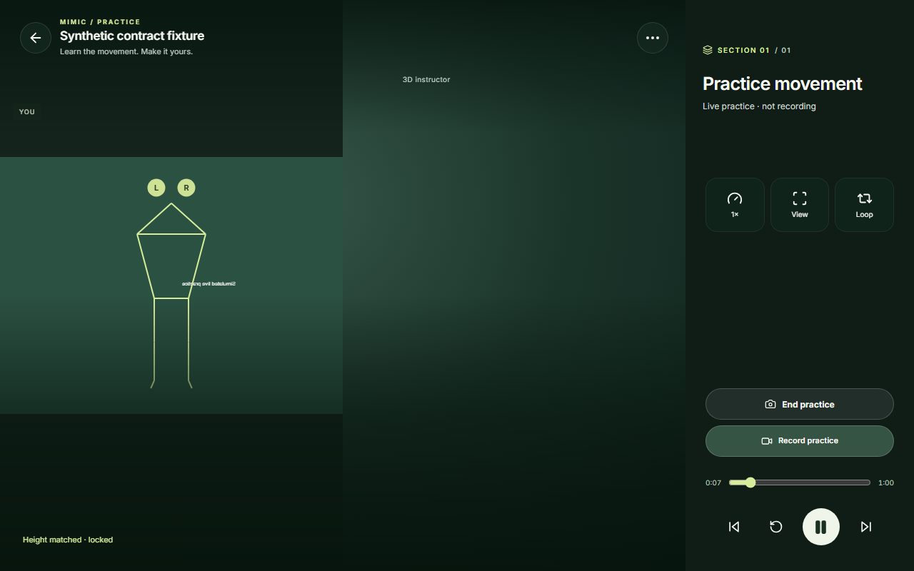
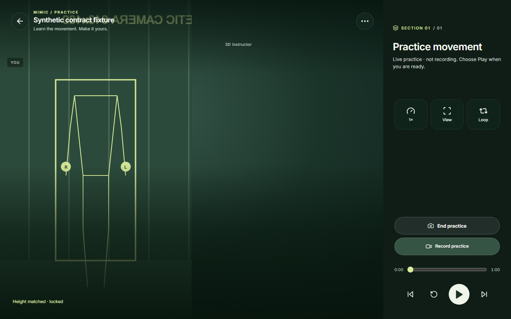
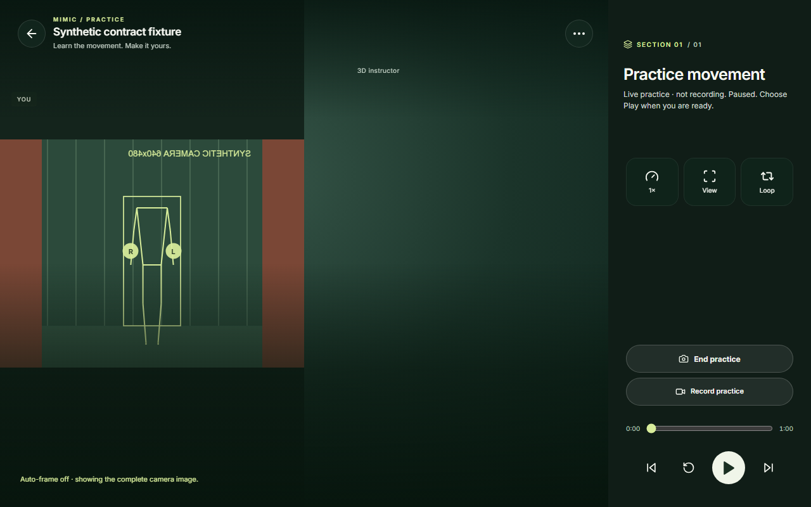
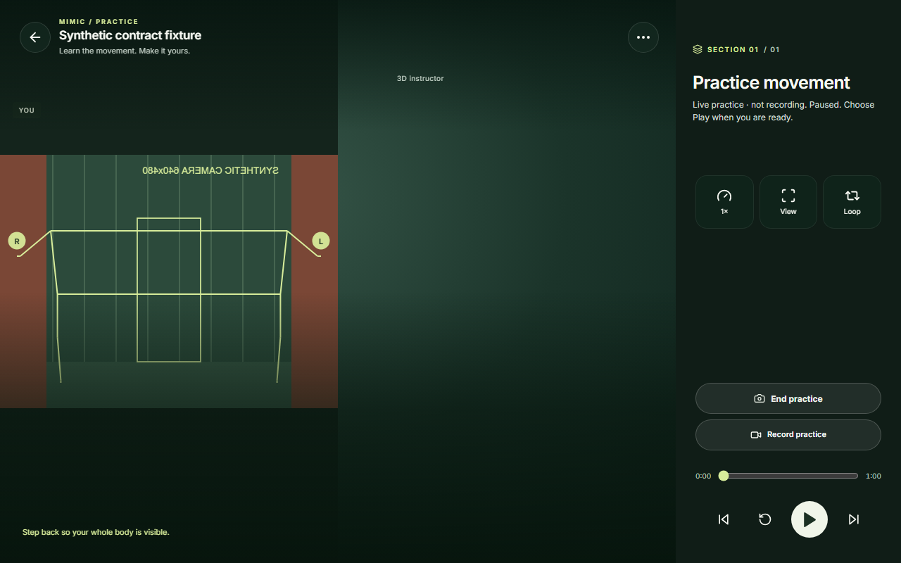
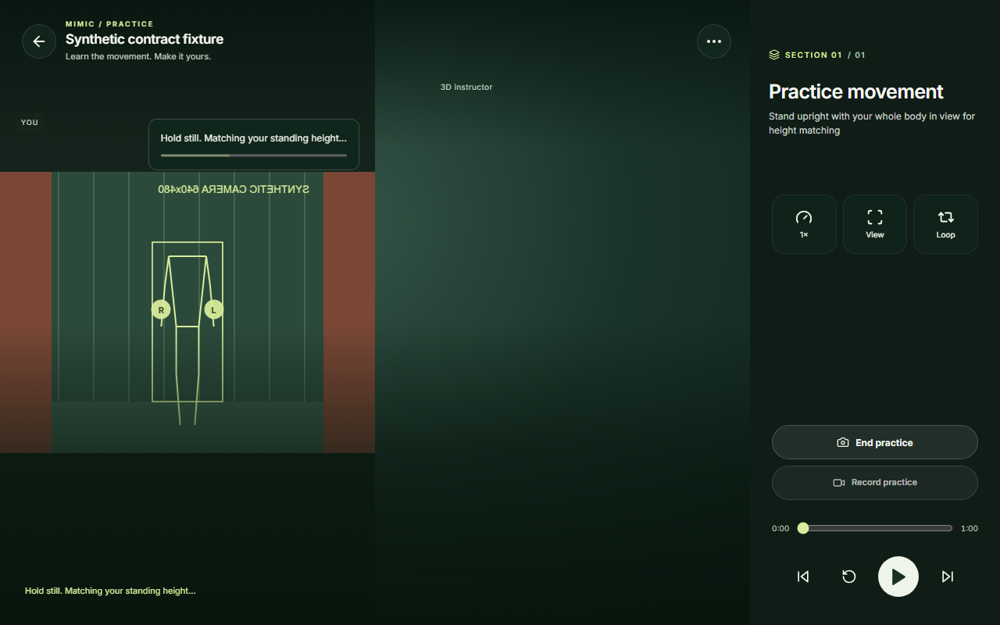
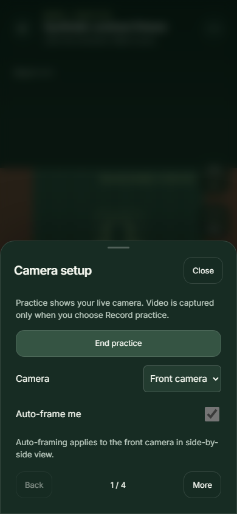
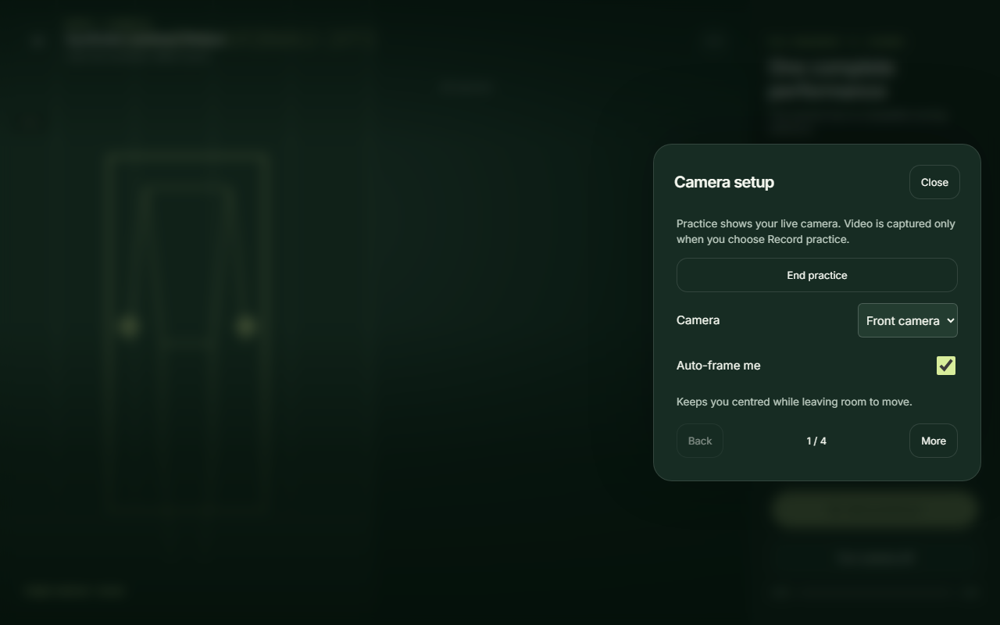

# Live camera auto-framing — implementation and verification

Date: 2 November 2026
Specification: [live-camera-autoframing-plan.md](live-camera-autoframing-plan.md)

## What changed

- `apps/web/src/camera-framing.ts` — pure geometry, pose validation, display transform and
  time-based `CameraFramingController`. No camera, DOM or React dependency.
- `apps/web/src/MimicInterface.tsx` — one render loop owns the transform; video, skeleton,
  hand labels and the camera tag/lifecycle consume it. Adds the **Auto-frame me** control in
  Camera setup and resets framing with camera/calibration/source epoch changes.
- `apps/web/src/practice.css` — full-pane clipped presentation wrapper; overlays stay above
  the video; height-matching card moved into the safe area above the contained image.
- `apps/web/src/practice-types.ts`, `apps/web/src/MotionStage.tsx` — separate-layout
  instructor placement follows the same transform when the instructor pane matches the
  camera pane; combined and instructor-only layouts keep their previous geometry.
- `apps/web/public/pose-worker.js` already returned the input frame timestamp; the
  main-thread message type now uses it, and the controller rejects stale or out-of-order
  framing input. No change to inference input or cadence.
- `apps/web/tests/camera-framing.test.mjs` — deterministic geometry/timing/reset tests.
- `scripts/verify_camera_framing.py` — headless Chromium regression with a synthetic camera
  feed and deterministic pose sequence.

Raw camera video, capture constraints, calibration values, scoring, recordings, recording
export and the transmitted camera track are unchanged. Only the local display is transformed.

## Framing policy as implemented

- Canonical space is the original, unmirrored video frame (normalised pose + source pixels).
- Pose bounds use all visible landmarks (face/head, shoulders, elbows, wrists, hands/fingers,
  hips, knees, ankles, heels, toe tips). A complete pose requires finite core landmarks, a
  visible head and visible hands/feet; low-visibility extremities produce fallback guidance,
  never a tighter crop.
- Padding: 15% of body width each side, 10% of body height above/below, minimum 3% of the
  source dimension each side. Source-edge overflow is checked before any clamping.
- Fill crop: the largest pane-aspect crop that contains the padded body and stays inside the
  source — the least magnification that covers the pane, not a face/torso zoom. If it does
  not exist, the complete source is shown with a contained fit and the existing guidance
  system asks the person to step back.
- Recent reliable extents are merged for 1 second so alternating punches/kicks do not pump
  the crop. Old extents expire, so recentering resumes.
- Implausible one-frame centre or body-scale jumps discard framing evidence and fall back.
- An unreliable pose freezes the crop currently on screen. Any in-flight tightening stops on
  that frame, and partial bounds never replace the last reliable padded bounds.
- The movement dead zone is only allowed to hold the old crop while that crop still contains
  the padded body. Loss of clearance recentres (or widens) immediately.
- Skeleton and hand labels stop rendering once the latest pose is older than the 900 ms
  tracking-loss threshold, so a stalled stream cannot leave ghost limbs on screen.

## Final tuning values

All values live in `FRAMING_DEFAULTS` in `apps/web/src/camera-framing.ts`.

| Parameter | Value |
| --- | --- |
| Landmark visibility threshold | 0.60 |
| Horizontal padding | 15% of body-box width |
| Vertical padding | 10% of body-box height |
| Minimum padding each side | 3% of source dimension |
| Source-edge margin | 3% |
| Stable acquisition | 500 ms continuous reliable pose |
| Re-tighten after a wider/fallback view | 1000 ms stable evidence |
| Recenter smoothing | 300 ms (time constant 100 ms) |
| Tighten smoothing | 600 ms (time constant 200 ms) |
| Centre dead zone | 5% of pane width/height |
| Brief-loss hold | 300 ms, no tightening |
| Full-frame fallback | 900 ms, and immediately on stale pose messages |
| Recent-envelope memory | 1000 ms |
| Jump rejection | centre > 25% of source, or body scale ratio > 2.2 / < 0.45 |

## Verification performed

Commands (from `apps/web`):

```text
npm test        # 50 tests passed, including 19 camera-framing tests
npm run build   # tsc --noEmit + vite build passed
```

Browser regression (headless Chromium, synthetic 640×480 canvas camera, deterministic pose
sequence; Vite dev server on `127.0.0.1:5173`):

```text
python scripts/verify_camera_framing.py
PASS: full-pane fill, auto-frame off contained, stale overlay hidden and recovered,
      wide-arm fallback, recovery, feet-edge fallback, resize without restart,
      mobile combined unchanged.
```

The regression checks, in order:

1. Height matching uses the complete contained image.
2. After acquisition the video destination covers the whole left pane.
3. Auto-frame off shows the complete source contained in the expanded pane.
4. Auto-frame back on covers the pane again.
5. Extended arms immediately widen to the complete image and show “Step back…”.
6. Arms down recovers the fill crop and clears the guidance.
7. Feet leaving the source frame uses the complete image and keeps the guidance.
8. A presentation-only resize (1280×800 → 1000×700) recomputes the crop and keeps the camera
   running without a permission prompt or height recalibration.
9. A simulated pose stall hides the skeleton and hand labels within the 900 ms overlay
   staleness window, then restores them when poses resume.
10. A 390×844 combined layout keeps the previous contained view and disables the control,
    with an explanation that auto-framing applies to the front camera in side-by-side view.

Unit tests also cover an in-flight tightening transition freezing on an invalid pose, a
pending safe expansion surviving a bad pose, and a small movement that sits inside the dead
zone but would lose padded-body clearance.

A separate desktop compete check loaded `?page=compete`, chose **Prepare to compete**, waited
for height matching, and confirmed the video covered the whole left pane and the
**Auto-frame me** control was enabled and checked. Practice and compete share the same
`MimicInterface` framing path; compete only changes copy and scoring state.

### Before / after

| View | Image |
| --- | --- |
| Before: short contained landscape rectangle |  |
| After: full-panel fill |  |
| Auto-frame off (complete image in expanded pane) |  |
| Wide arms: intentional full-body fallback with unused space |  |
| Height matching: full frame; card sits above the image |  |
| Combined mobile: unchanged contained view, control disabled |  |
| Desktop compete: same full-panel framing |  |

The screenshots use a synthetic camera because this environment has no physical webcam. They
demonstrate geometry, mirroring once, overlay alignment, fallback and layout behaviour, not
image quality from a real sensor.

## Remaining limitations and checks not run

- **Physical devices not run.** No desktop webcam, Android Chrome or iPhone Safari was
  available in this environment. A real-camera pass for standing, punches, kicks, turns and
  floor-level movement remains outstanding; it is not claimed as passed.
- MediaPipe landmarks approximate hair and loose clothing; padding may need to increase after
  visual review with a real camera.
- Identity tracking is out of scope. A switch to a nearby person is only rejected as an
  implausible jump; it cannot be proven from one pose stream.
- Fast movement between tracking updates can still clip by a few centimetres; the padded
  envelope and immediate widening reduce but cannot eliminate that.
- Alternating extremes keep the full frame while the 1-second envelope is live, then
  re-tighten after the configured stable delay.
- Overlay clearance is handled by the full pane plus compact guidance/card placement, not by
  a per-overlay subject-area solver.
- Combined, instructor-only/PiP, recorded-test, rear-camera and paired remote displays keep
  their existing behaviour; auto-framing is inactive there.
