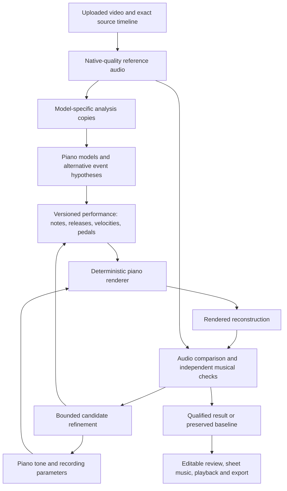

# Piano performance reconstruction: developer implementation plan

Date: 12 November 2026  
Status: development handoff; proposed work, not an implementation or accuracy claim  
Initial supported input: solo-piano audio from an uploaded video

**Current developer handoff:** follow the
[continuation and reuse plan after the A0–C foundations](piano-reconstruction-continuation-and-reuse-plan.md).
It retains the new modules, lists reproduced harness corrections, identifies the licensed
Kong inference/checkpoint route, defines the provisional listening instrument and orders
the real-renderer/model-adapter work. It supersedes treating the whole Kong model family
as blocked because one training repository has no license file.

Commercial-data route: **selected and source terms verified**. Use Vienna 4x22 original
audio with its CC BY 4.0 corrected performance references, plus VCSL CC0 piano samples
and project-authored MIDI controls. Salamander CC BY 3.0 is the richer renderer candidate.
See the [concrete selection, downloaded-file checks and conditions](piano-reconstruction-rights-register.md).
SMD/MAESTRO permission is not a prerequisite for this route. Keep Phase A0 checks for
new or ambiguous inputs; do not turn published permissive grants into an unnecessary
blanket requirement for bespoke permission.

The companion [acceptance specification v1](piano-reconstruction-acceptance-v1.md)
is part of this plan: it sets the renderer decision process, provisional numerical
quality gates, listening-study scope and measured runtime milestone. Its numbers are
requirements to validate, not existing performance claims. Both documents must be
handed to the developer together.

**Reuse checkpoint before custom estimator development:** read the
[repository review and local inference experiments](piano-reconstruction-repository-review-2026-11-12.md).
Published VeloEst inference already ran successfully on our clip and improved average
velocity error on one public development probe, with some damaged values still present.
Benchmark that component before building another velocity estimator. The review also
distinguishes existing correction loops, narrow heuristics and sound-generation models;
none is assumed to solve the entire reconstruction objective without validation.

## 1. Objective

Reconstruct an uploaded piano performance as editable notes and performance controls whose generated playback matches the original recording as closely as possible in every audible aspect: notes, rhythm, expression, articulation, pedal, piano tone and recording acoustics.

The product ambition is **audible indistinguishability from the original**. This is a substantially broader objective than producing a plausible MIDI transcription or correcting selected Basic Pitch events. It must be pursued through measured milestones; it cannot be promised for every arbitrary recording.

The reconstructed sound must be generated by the editable performance and declared instrument/recording model. Simply replaying the original recording, or mixing it into the reconstruction to conceal errors, does not satisfy the objective. The original remains available as the comparison reference.

There are two complementary acceptance tracks:

1. **Performance correctness:** the editable notes and controls correctly describe the performance, including attacks, releases, dynamics and pedal.
2. **Audio fidelity:** rendering that performance produces sound that listeners cannot reliably distinguish from the source within a declared input domain and test protocol.

A convincing sound with incorrect notes fails the first track. Correct notes played through a mismatched piano fail the second. Both tracks must pass before claiming a faithful reconstruction.

## 2. Why this change is necessary

The current pipeline detects notes, applies spectral checks and produces approximate synthesized playback. It does not optimize the complete rendered result against the recording.

The latest evidence is recorded in [the implementation report](qualification/piano-expression-implementation-2026-11-12.md):

- The retained 14.677-second upload produced 34 unchanged events, with zero expression proposals.
- On 48 held-out rendered performances, 142 deliberately corrupted durations were repaired, but there were no duration corrections to natural decoder errors.
- On 40 public performances and 3,271 matched sampled notes, the conservative spectral calibration made zero safe velocity edits.
- A separate offline piano-specific model reduced velocity MAE from 22.51 to 12.13 MIDI units on a different paired population of 3,241 notes. This is promising evidence for a better starting model, not a complete reconstruction result.

Software tests and safe abstention are necessary, but neither demonstrates that playback sounds closer to the original. This plan adds that missing objective, architecture and evidence.

## 3. Current gaps and required changes

| Current behavior | Gap relative to reconstruction | Required change |
|---|---|---|
| Basic Pitch is the primary event source | Its errors constrain later correction; its amplitude is used as approximate velocity | Benchmark piano-specific transcribers and allow a better model to become the primary source |
| Local spectral checks around proposed notes | No complete rendered-audio comparison or iterative refinement | Add deterministic rendering, comparison and bounded optimization |
| Expression attribution uses supplied pitches | A missing pitch is absent from that stage's explanation | Maintain alternative note hypotheses and support add/remove/split/merge operations |
| One performance duration plus separate written duration | Key release, audible ending and pedal sustain remain conflated in playback | Introduce explicit, versioned performance semantics |
| No qualified pedal reconstruction | Sustain and decay cannot be faithfully reproduced | Estimate and render pedal controls; qualify their semantics separately |
| Browser oscillator with a few harmonics and fixed response curves | Tone, transient, release and dynamics differ substantially from an acoustic piano | Introduce a realistic renderer shared by evaluation and product playback |
| 22,050 Hz mono analysis derivative | Appropriate for current inference, insufficient as the sole high-fidelity reference | Retain native-quality reference audio separately |
| Conservative expression categories disabled | No demonstrated automatic accuracy gain on the user's clip | Keep existing guards; build and qualify a genuinely useful reconstruction path |
| Software and note-level tests | They do not establish perceptual similarity | Add audio metrics, independent event references and blinded listening |

The present preview also includes compression and hand-selected gain/brightness curves. These may help an approximate audition, but they are not a fitted model of the uploaded recording. Do not use their output as the final reconstruction reference.

## 4. What to retain and what this plan supersedes

Retain raw model outputs, immutable AI baselines, source/working hashes, scoped qualification, owner-only diagnostics, correction histories, rollback, profile pinning, failure fallback and separation of written notation from performance timing.

This plan broadens [the earlier expression plan](piano-expression-improvement-plan.md): key release, pedal and source-sound matching now enter scope because they are essential to the stated objective. Historical audible-duration qualification must not authorize key-release editing. Existing calibrated velocity approvals must not automatically authorize a different model, renderer or recording domain.

Existing verification and attribution code can generate evidence and candidate proposals. It must not be presented as a complete reconstruction engine. Preserve old benchmarks so new methods can be compared honestly.

Initial scope excludes mixed-instrument/vocal separation. Detect unsupported material and disclose limited reconstruction rather than forcing a piano explanation. Expansion to mixtures requires its own reference data and qualification. Keyboard video may eventually corroborate physical actions when visible, but is not required for the initial audio-based pipeline.

## 5. Target architecture and integration point

Run reconstruction in the background worker after source extraction and initial transcription, before the final working draft is handed to the review UI. Keep the initial model result immutable. The reconstruction engine owns the candidate performance for this branch; do not blindly chain old and new correction stages and apply the same edit twice.

Initially run this as an offline/shadow branch. Compare (a) current production path, (b) piano-specific model alone, (c) that model plus realistic rendering, and (d) full refinement. Only the qualified branch may supply automatic working-draft changes. Existing jobs and lessons retain their original versions unless explicitly reanalyzed.

The user experience remains: upload → processing → editable result. Users do not operate the comparison script or approve individual internal optimization steps. Optional comparison playback and restore-original controls remain available.

## 6. Phase A — freeze targets, baselines and reference data

### Phase A0 — mandatory data and asset rights gate

**Selected route:** the [rights/source register](piano-reconstruction-rights-register.md)
now identifies commercially permissive sources and records the files actually obtained
and inspected. Proceed on that route with attribution and pinned provenance. The
following requirements prevent incompatible additions; they do not require negotiating
SMD/MAESTRO permission or waiting for a new corpus before starting development.

Resolve the lawful data route before downloading new corpora, training/calibrating on
them, or using them for commercial-development evaluation. Existing research artifacts
are not evidence of clearance. This gate also precedes data-dependent work in Phases
C–F, including Phase D model comparisons; contract work and tests using independently
cleared fixtures can proceed.

Create `docs/piano-reconstruction-rights-register.md` and a machine-readable rights
manifest. The register must cover each dataset, recording, MIDI annotation, piano
sample library, pretrained checkpoint and derived calibration/render asset. Record:

- Exact source/version/hash, rights holder, license text/version and permission evidence.
- Intended project context and separate decisions for acquisition/storage, commercial
  internal evaluation/model selection, training/fine-tuning, calibration, hosted inference,
  demonstration/publication and redistribution of original or derived assets.
- Terms requiring attribution, noncommercial use, share-alike or restrictions on outputs;
  questions about applicability must be resolved by an authorized rights/legal reviewer.
- Approved/prohibited uses, unresolved questions, decision owner/date and expiry where
  relevant. A missing or ambiguous decision defaults to unapproved for that use.
- Provenance links from every derived model/calibration/sample/render asset to its inputs.
  Review checkpoint terms separately from code and training-data terms; neither a
  permissive code license nor dataset restrictions alone resolves all model-use questions.

SMD is published under CC BY-NC-SA 3.0; MAESTRO under CC BY-NC-SA 4.0. Neither is a
default cleared source for this commercial-product plan. Calling an experiment
"internal research" or restricting uploads to solo piano does not itself establish
permission. A restricted product domain can narrow the data needed, but cannot cure
incompatible data terms. Do not infer that every piano corpus has the same license.

Choose and document a viable route before Phase A exits:

1. Obtain written permission covering the project's actual commercial uses, where
   available; do not assume a public dataset's distributor can grant every needed right.
2. License suitable aligned audio/MIDI data with the required usage rights.
3. Commission original paired performances with appropriate performer, recording,
   composition and training/evaluation permissions. For a narrow first domain, use
   cleared music and recordings from a controlled piano/capture setup.
4. Use cleared synthetic performances and licensed instruments for infrastructure and
   controlled tests. These cannot alone satisfy the real-performance qualification gate.

Treat previously obtained SMD excerpts, fitted calibrations and dependent artifacts as
**not approved for commercial qualification or shipping** until reviewed. Inventory
their provenance and exclude them from default qualification/profile packaging; this
plan does not authorize deleting existing files or assume that every prior use was
unlawful. Historical results can remain identified as research observations, not a
commercial release gate. Continue experiments on restricted corpora only where the
specific intended use has been cleared.

Implement a rights preflight before dataset fetch/ingestion, benchmark execution,
training/calibration and profile packaging. Require an explicit intended-use value and
matching approval evidence. Block unknown, incompatible or unresolved inputs and
dependent artifacts; do not allow a filename, a generic "research" switch or a manual
policy edit to bypass the decision. Access restrictions protect a corpus but do not
replace permission.

**A0 exit evidence:** the selected published grants and intended uses are recorded,
attribution/provenance is retained, and preflight tests reject incompatible dependencies.
Permissively licensed sources use their published grants; seek specific review only
for unresolved terms or rights. The selected data route exists now; remaining ingestion
and preflight code belongs to implementation. Do not wait until Phase D to examine new
inputs or weaken the human-reference quality gates to work around a data limitation.

### Required development

1. Write the target contract distinguishing physical/captured key release, pedal-extended note activity, audible end, written duration, captured MIDI velocity, renderer-conditioned velocity and audio gain.
2. Freeze current code/profile/model hashes, the 34-event result and the old synthesized audition for the user's clip. Preserve the exact retained upload rather than accidentally comparing it with the untrimmed source.
3. Create a dataset manifest with audio/MIDI hashes, performance/piece/instrument/recording identities, alignment metadata, source/license and development/calibration/holdout assignment.
4. Use real paired original audio and captured MIDI for event, release, velocity and pedal evaluation. Validate controller and release semantics rather than assuming all dataset MIDI conventions agree.
5. Use independent audible-ending intervals for audible-duration scoring. Masked or inseparable endings are unscorable. MIDI key release is not an audible-ending reference.
6. Obtain independent checked pitch/onset annotations and uncertainty notes for the user's excerpt. Where release or velocity cannot be verified from that recording, report the limitation instead of inventing ground truth.
7. Include quiet notes under chords, repeated same-pitch strikes, fast passages, pedal transitions, bass, high notes, reverb, compression, detuning and multiple recording domains.
8. Keep deliberate corruptions as debugging controls, separately reported from natural model errors. All data already inspected during development is now development evidence. Reserve fresh holdout performances and, where feasible, pieces and recording domains. Record overlap with each pretrained model's training data.

### Exit gate

Phase A0 must pass first. The developer can then reproduce baselines using approved
inputs, explain every target's semantics and run a fixed evaluation without label
leakage. Rights for intended downstream uses are documented rather than deferred to
model selection or release. Public availability does not imply unrestricted product use.

## 7. Phase B — version the performance and audio contracts

### Required data model

Introduce a versioned performance document with at least:

| Field/group | Required semantics |
|---|---|
| `onset_seconds` | Performance attack on the exact source timeline; no automatic score quantization |
| `pitch_midi` | Discrete played pitch; keep tuning deviations in the sound model unless independent evidence supports pitch-specific tuning |
| `key_release_seconds` | Nullable estimated/captured physical release, with provenance and uncertainty |
| `audible_end` | Nullable earliest/latest plausible end interval and scorable/uncertain status |
| `velocity_midi` | Nullable 1–127 played velocity estimate, with method/domain/uncertainty; do not silently relabel Basic Pitch amplitude |
| Render controls | Renderer-specific intensity/controls stored separately when not equivalent to captured velocity |
| Pedal events | Typed sustain/soft/sostenuto controls when supported, normalized continuous values and times, confidence/semantics |
| Written notation | Independent score rhythm, ties, voices and note identity links; performance refinement must preserve deliberate score edits |
| Sound model | Renderer, asset/model hashes, version, piano identity, tuning, gain, effects and channel configuration |
| Provenance | Baseline/model hypotheses, source identity, applied changes, scope, objective evidence and policy identity |

These names describe the required contract; finalize exact schema names in this phase. Use explicit schema versions, finite-value/range validation and stable event IDs. Unknown fields must remain unknown, not invented defaults masquerading as measurements.

### Migration and consumers

- Audit `duration` in playback, MIDI export, notation, piano-key animation and assessment before assigning new semantics. Never reinterpret old saved durations silently as physical releases.
- Keep a legacy reader/adapter. New data uses explicit timing semantics; existing lessons keep legacy playback until intentionally migrated.
- Audit whether `notation_duration` is seconds or notation ticks in each layer; convert explicitly without using it as a performance release.
- A new performance version likely requires coordinated draft/reference/API/parser changes. Do not independently add fields that strict validators drop or reject.
- MIDI export uses intended note-off plus controller events. If release is unknown, use a documented estimated export strategy and disclose its status; do not export audible end as measured key release.
- Assessment should score only supported targets. Pedal-extended sound must not instruct learners to hold a key for the entire acoustic tail.
- MIDI alone does not encode the complete piano/room model. Package the render profile or provide rendered audio when source-like playback must be portable.

### Exit gate

Round-trip tests preserve new semantics and old lessons. Duration, pedal and written rhythm remain distinct across every consumer.

## 8. Phase C — build the renderer and comparison harness first

### Renderer interface

Implement one explicit interface:

`render(performance, sound_profile, output_spec) → audio + identity + latency + control_support`

It must support deterministic offline output, exact timestamps, repeated strikes, overlapping notes, release behavior, velocity response and declared pedal support. Test any half-pedal or resonance claim explicitly; a MIDI controller API does not prove realistic acoustic behavior.

The first fidelity prototype is **sfizz plus Salamander Grand Piano V3**: an SFZ
engine/asset pairing, not a FluidSynth SoundFont. Separately benchmark FluidSynth plus
a project-built VCSL CC0 SF2 as a control/cost baseline. Record engine, asset, mapping
and dependency licenses independently. Test Salamander's extended-opcode compatibility;
do not assume an arbitrary SFZ or converted SF2 preserves its behavior. The archived
sfizz code also requires an identified maintenance owner or vetted maintained fork.

Neither pairing is presumed capable of indistinguishability. Deliver the measured
renderer decision in [acceptance specification section 2](piano-reconstruction-acceptance-v1.md#2-renderer-selection-is-a-separate-mandatory-delivery).
If no candidate meets the feature, rights, quality and cost gates, fail this milestone
and evaluate/procure another suitable pairing. DDSP-Piano is an offline research
comparison, not a product-ready default or approved fallback.

Remove the simple browser oscillator from the fidelity acceptance path. It may remain an explicitly approximate fallback. Avoid the current arbitrary master compression in reference renders; fit recording compression only when supported by evidence and bounded complexity.

### Reference audio

Retain a native-rate/channel PCM reference decoded from the source, with exact sample counts and timestamps. Keep model-required mono/resampled derivatives separately with a documented mapping. Decoding compressed video cannot recover lost information, so describe this as preserving available fidelity, not recovering a lossless original.

### Comparison harness

For identical source excerpts, retain source audio, candidate performance, sound profile, rendered audio, metrics and provenance. Support synchronized A/B and diagnostic plots. Correct fixed renderer latency explicitly. Do not time-warp the final candidate to hide rhythm errors, normalize away dynamics, or optimize arbitrary per-frame EQ that conceals missing notes.

Report both a calibrated/global-gain comparison and the delivered absolute playback level. User volume is separate from fitted recording gain. Preserve stereo for the final sound comparison, while allowing mono features for selected analysis tasks.

### Exit gate

Known MIDI rendered through the same instrument round-trips with correct timing, velocities and pedal behavior; repeat renders are deterministic within a declared tolerance. Deliberately wrong timing/pitches/dynamics cause the expected metric degradation. Listening to the same candidate in the browser and evaluation harness does not introduce an unexplained second sound engine.

### Phase C-R — runtime/cost characterization milestone

Before integration, measure 15 s, 60 s and 300 s workloads on an identified worker,
including dense pedal/repetition cases, warm/cold caches and repeated optimization
renders. Characterize the renderer here, update after Phase D model selection and
Phase F refinement, and publish a versioned runtime profile before Phase G.

Initial engineering targets are p95 processing time at most `max(60, 3 × source_seconds)`
seconds, renderer-only real-time factor at most 0.25, at most 8 GiB RAM / 12 GiB GPU
memory per job and warm local audition regeneration within 3 s. These are unmeasured
targets, not current capabilities. [Specification section 5](piano-reconstruction-acceptance-v1.md#5-runtime-memory-and-cost-work-package)
defines reference hardware, repetitions, hard deadlines, cost targets and fallback.
The existing 60 s/500-event expression caps cannot substitute for this milestone.

## 9. Phase D — select a stronger initial piano transcription

Prerequisite: Phase A0 clearance for each intended benchmark use and each checkpoint.
Do not start commercial model comparisons on SMD/MAESTRO merely because historical
research runs or third-party model cards used them. Replace unapproved reference data
with the cleared route selected in Phase A.

Benchmark Basic Pitch, Transkun and the existing ByteDance model under pinned, reproducible versions and checkpoint hashes. Retain raw predictions and precise decoding configuration where available. Do not assume an advertised benchmark result transfers to our uploads.

For each model measure:

- Missing/extra notes, repeated-note recovery, pitch/onset matching and note F1.
- Onset absolute error distribution, including median and upper-tail errors.
- Key-release versus pedal-extended offset accuracy under the checkpoint's declared semantics.
- Velocity error against captured MIDI, separately from renderer intensity fit.
- Pedal onset/offset and frame/control accuracy for supported pedal types.
- Unrefined rendered similarity, runtime, memory and subgroup behavior.

Transkun checkpoint selection must explicitly record whether offsets are pedal-extended; its default checkpoint and other variants differ. ByteDance supports pedal transcription, but verify the actual installed checkpoint and output path. Do not silently discard controller events during conversion.

Choose a primary model using development data. Preserve alternate hypotheses only where useful; agreement between models is supporting evidence, not ground truth, and blind union of their notes will add false positives. Basic Pitch may remain an alternative or fallback rather than the mandatory primary model.

### Exit gate

A fixed model/checkpoint/decoder and performance adapter outperform the frozen baseline on the declared development objectives, with documented failures. Existing public velocity comparison alone is insufficient to pass this full gate.

## 10. Phase E — fit piano tone and recording characteristics

Use a small, bounded sound profile that can explain real recording differences:

- Piano/sample/model selection; pitch-dependent attack and decay characteristics.
- Global tuning and, where identifiable, bounded per-pitch tuning/inharmonicity.
- Velocity-dependent brightness and loudness response.
- Global gain and conservative static spectral balance.
- Pedal/resonance behavior supported by the renderer.
- Room/reverb, stereo balance and a constrained recording chain.

Fit sound parameters using multiple reliable attacks and decays across the passage, then evaluate on reserved passages where possible. A short, dense excerpt may not identify all parameters; keep unsupported parameters fixed and uncertainty explicit. Do not claim a 14-second clip uniquely identifies a piano.

Distinguish captured/played velocity from the renderer-conditioned value required by a different instrument. A useful sound match can require renderer-specific mapping without proving the original physical strike velocity. Keep both concepts separate in storage and evaluation.

Freeze instrument parameters while testing note edits; freeze notes while fitting instrument parameters. Alternate under bounded updates. This prevents unrestricted sound fitting from absorbing transcription errors. Final tone matching is a milestone, but a credible renderer and initial sound fit are prerequisites for reliable note refinement.

### Exit gate

The fitted sound improves independent comparison passages without creating new note controls or changing checked notes to compensate for timbre. Known correct-note fixtures remain correct under deliberate instrument mismatch tests.

## 11. Phase F — implement bounded reconstruction refinement

### Candidate operations

| Operation | Candidate evidence | Independent guard |
|---|---|---|
| Add a note | Unexplained pitched attack, model alternative and local audio evidence | Distinguish harmonics/resonance from an independently struck note |
| Remove a note | Little independent support; improved reconstruction after removal | Protect quiet notes masked by louder notes |
| Move onset | Attack/transient evidence and neighboring hypothesis | Preserve repeated strikes and expressive timing |
| Split/merge | Repeated-attack evidence versus fragmented activation | Do not merge genuinely repeated notes or split pedal tails |
| Change release | Release model evidence, renderer response and captured-release semantics | Do not substitute audible end for key release |
| Change velocity/intensity | Attributable attack and calibrated/renderer-specific response | Do not repair global gain or timbre mismatch by changing a correct strike |
| Change pedal | Passage-wide sustained energy and pedal-model evidence | Evaluate all affected notes and surrounding tails, not one event |
| Change sound profile | Consistent recording-wide mismatch | Bounded controls; no arbitrary error-canceling audio layer |

### Objective and optimization

Use a versioned weighted objective with separately reported components: multi-resolution spectral differences, attack alignment, pitch-related energy, loudness/envelope differences, decay behavior and supported stereo/room features. Waveform difference can be a supplementary metric when phase/latency permit; it must not be the sole objective for an acoustically different renderer.

Include penalties for unsupported complexity, excessive events, implausible pedal behavior and departure from reliable model evidence. Select weights and limits on development data; freeze them before holdout. No single spectral residual is a proof of correct notes.

Start with bounded coordinate search/beam search over discrete edits and local continuous search for timing, intensity and sound controls. Where a differentiable renderer supports a faithful gradient, evaluate it as a later accelerator rather than a requirement to rewrite the whole system.

For each proposed edit:

1. Establish exact baseline performance/audio/profile identity and a neighborhood including pre-existing resonance and the complete affected tail.
2. Render no-change and bounded candidate alternatives using the same sound profile.
3. Compare the changed region, surrounding context and whole passage; reject boundary artifacts or displaced errors.
4. Require relevant independent musical evidence and improvement beyond the development-frozen materiality threshold.
5. Reject uncertainty/conflict, preserve already checked attributes, and record no-change as a valid result.
6. Apply a coherent transaction to the candidate performance, not several conflicting overlapping edits.
7. Re-render and rescore the final complete candidate; local improvements must survive their joint application.

Repeated same-pitch notes, pedal and long decays require stateful context across chunk boundaries. Chunking must retain renderer state or preroll and sufficient tails; do not reset the instrument every few seconds. Unknown/unsupported passages retain the baseline. Bound iterations, candidate counts, wall time and memory, and disclose partial coverage.

### Exit gate

The refinement improves natural model errors beyond model-only output on independent data, preserves clean controls and passes category/scope gates. Recovery of artificial corruption alone does not pass.

## 12. Phase G — integrate worker, API, editor and playback

Prerequisites: a selected engine/asset pair with documented terms and tested controls,
and the measured runtime/cost profile from Phase C-R, refreshed after model/refinement
selection. Integration may not invent resource limits or promise turnaround while
these dependencies remain unmeasured. Offline prototypes can continue independently.

### Existing code to change or audit

| Area | Existing files | Required work |
|---|---|---|
| Extraction/job orchestration | `scripts/music_worker.py` | Native-quality reference derivative, model derivatives, reconstruction stage, resource limits and fallback |
| Transcription adapter | `scripts/music_basic_pitch_adapter.py` | Model-neutral performance handoff; do not force non-Basic-Pitch results through Basic Pitch semantics |
| Existing evidence | `scripts/piano_verifier.py`, `scripts/piano_expression.py`, `scripts/piano_expression_evidence.py`, `scripts/piano_corrections.py` | Reuse as evidence/compatibility; separate reconstruction authority and target semantics |
| Profiles/identity | `scripts/prepare_piano_decoder_profile.py`, `scripts/music_run_profile.py` | Versioned reconstruction profiles; hash every runtime dependency, renderer asset, checkpoint and effective setting |
| API contracts | `apps/api/contracts.py`, `packages/lesson-schema/index.ts`, `packages/lesson-schema/parse.ts` | Versioned notes, releases, pedals, sound profiles and render identities |
| Review/application | `apps/api/music_review.py`, `apps/api/music_verification.py`, `apps/api/music_corrections.py` | Transactional validation, scoped application, edit ownership, full rollback and concurrency protection |
| Notation | `packages/music-notation/types.ts`, `build.ts`, `parse.ts` | Preserve written rhythm/voices/ties and links to refined performance; round-trip new fields |
| Browser playback | `apps/web/src/music/DraftNotePreview.tsx`, `note-audition.ts`, `music-velocity.ts` | Shared realistic audition path; source clock synchronization, accurate seek and pedal context |
| Review/editor | `apps/web/src/music/MusicDraftReview.tsx`, `MusicLessonEditor.tsx`, `VerificationReview.tsx`, `working-edits.ts` | Seamless corrected draft, original/candidate A/B, progress/fallback, stale-render invalidation and restore |
| Publication/export/learner | All consumers of the draft/reference and `duration` | Ensure the approved performance, pedal and renderer semantics survive finalization and are used consistently |

Suggested new modules: `piano_performance.py`, `piano_render.py`, `piano_reconstruction_metrics.py`, `piano_reconstruction.py`, `benchmark_piano_reconstruction.py` and `qualify_piano_reconstruction.py`. These are proposed names, not files already implemented. Prefer a model-neutral worker interface over making the existing Basic Pitch-only profile accept incompatible semantics.

### Artifacts and application contract

Retain immutable baseline and final performance documents, sound profiles, source/reference identities, candidate/final renders, comparison report, coverage/uncertainty and complete edit history. Hash the performance, controls, instrument assets, renderer, effects and output settings into the render identity. Any note, pedal or sound edit invalidates the corresponding cached render.

An application decision must bind source, baseline, current working revision, user-edited state, model/decoder, renderer/profile, objective version and qualified policy. Protect human edits from background overwrite. Existing stale-hash and source checks must cover the new artifact set. Failures leave the most recent valid draft intact; optimization must not delay or destroy an already available result indefinitely.

Apply complete performance/control/sound changes atomically. Restoring an original result must restore its compatible controls and sound profile, not just note rows. Reports and large render artifacts need owner authorization, existing retention controls and bounded storage. Do not expose private raw analysis through generic assets.

### Browser strategy

For the first implementation, server-rendered audio is the authoritative reconstruction audition, with cached results and edit-triggered regeneration. Make playback and keyboard animation follow the same audio clock and documented source offset. Include tail handling at the clip boundary and preroll/state for seeking into held/pedaled notes.

Provide responsive editing while rendering. If using a temporary approximate local audition, label it clearly and never score it as the final reconstruction. A later real-time client renderer must reproduce the same pinned instrument/control semantics and pass audio-equivalence checks. Mobile users must not need to load large models or sound libraries merely to review a processed draft.

Assessment, sheet edits and playback must preserve manual changes. Decide and test what changing a written quarter note means for performance timing; do not silently quantize the original performance merely to make the score tidy.

### Exit gate

A real upload completes automatically, displays an editable improved draft, plays the exact evaluated reconstruction and restores the baseline correctly on desktop/mobile. Edits invalidate stale audio. Published lessons and exports preserve the reviewed semantics. No manual comparison script is required in the user flow.

## 13. Phase H — qualification and evidence of success

### Three evaluations are required

1. **Event correctness:** independent exact-pitch/onset matching, releases under correct semantics, captured velocities, pedal controls, audible-ending intervals and clean-control damage. Report full note recall; velocity scores conditional on matched notes must not conceal missing notes.
2. **Rendered similarity:** original versus reconstructed audio using the frozen objective, component metrics and distributions by passage/domain. Compare model-only and refinement under the same renderer to isolate performance gains; then compare sound fitting separately.
3. **Listening:** randomized, blinded, loudness-controlled A/B preference/similarity and an appropriate discrimination test for any indistinguishability claim. Define sample size, listeners, playback conditions, effect sizes and analysis in advance. Failure to find statistical significance in a small ABX test is not proof of equivalence.

### Concrete acceptance protocol

- Retain current edit-category minimums: at least 40 distinct contributing held-out human performances, at least 20 suggestions, at least 95% observed correction precision and zero measured damage under the existing target definition. Forty recordings with zero suggestions cannot qualify automatic changes. Report uncertainty; zero measured damage is not a guarantee for future uploads.
- Qualify new targets such as key release and pedal independently with appropriate references and scope. Do not inherit audible-duration approval.
- Use the [versioned numerical acceptance specification](piano-reconstruction-acceptance-v1.md).
  Initial requirements include at least 95% analysis coverage, 20% natural-error
  correction coverage, 20% category-error reduction, 10% reconstruction-objective
  improvement and a 10-point mean listening-similarity gain with a lower 95% confidence
  bound above 5 points. Preserve the existing precision/damage/edit-performance gates.
  Definitions, denominators, uncertainty and subgroup rules are in that specification.
  These are provisional product requirements, not empirically justified predictions.
  Run development pilots, freeze the manifest before holdout and accept failure;
  any substantive revision needs a new version, rationale and fresh untouched data.
- Require gains over both the current system and the selected piano model alone. Reject a refinement stage that adds complexity without improving the stronger model.
- Report tails and regressions, not only averages. Separate instruments/recording domains, easy isolated notes, polyphony, repeats and pedal-heavy passages.
- Compare the full delivered pipeline, including the actual product renderer, with immutable artifacts. Software correctness, perceptual closeness and literal waveform identity are separate claims.
- Mark a stage as implemented-but-unqualified when it runs but does not achieve the required benefit. Do not enable categories or weaken gates to satisfy a delivery label.

The user's clip is a required acceptance example, but cannot be the only qualification dataset or the clip used to tune every rule. Deliver original/baseline/final audio, editable performance, synchronized comparison and independent checked annotations with unscorable attributes explicitly identified.

### Listening study and claims deliverable

Assign evaluation/statistics, recruitment and product/claims owners. Scope a 12-listener
development pilot and a confirmatory recruitment floor of 60 valid listeners in two
cohorts, with at least 24 untouched performance excerpts and 24 ABX trials per listener.
Final sample sizes must be justified by a predeclared clustered power simulation;
the recruitment floor alone is not proof of power. Budget participant time/payment,
screened equipment, analysis and claim review as a separate work package.

[Specification section 4](piano-reconstruction-acceptance-v1.md#4-listening-study-work-package-and-claim-control)
sets a 90% power target, practical discrimination bound, confidence/multiplicity rules,
quality ratings, exclusions, preregistration and required evidence artifacts. A passed
practical discrimination bound does not prove literal identity. Product wording must
remain within the studied domain and conditions; a small non-significant ABX result
cannot authorize “audibly indistinguishable.” No claim is released if a properly powered
study cannot be completed. This work package is separate from automated regression tests.

## 14. Required tests

- Schema/migration round-trips; unknown release/velocity remains unknown; old lessons retain behavior.
- Controlled renderer tests for velocities, repeat strikes, overlapping notes, key release, supported pedals, resonance, tail clipping and deterministic output.
- Correct notes under wrong instrument/gain/reverb: sound fitting must not create wrong notes to explain timbre.
- Missing/extra/shifted notes; quiet notes under loud chords; repeated notes; octave-related partials; detuned piano; silence/noise and unsupported mixtures.
- New release/pedal targets scored against suitable references, independently of audible endings.
- Stateful whole-file versus chunked rendering/refinement, including seeks into sustained notes and edits near chunk boundaries.
- Multiple local changes combined: final full-pass score and musical checks must still improve.
- Stale source/working/render/profile hashes, manipulated reports, wrong calibration/domain, overlapping edits, manual-edit concurrency and full rollback.
- Timeout, cancellation, renderer failure, oversized job, unsupported audio and partial processing preserve baseline and report coverage.
- Worker → report → API → review → published lesson/export acceptance, including correct source/video synchronization.
- Desktop/mobile playback, editing, pending/stale render state, original/candidate A/B, restoration and no audio-clock drift caused by UI animation timing.

Run meaningful unit/integration tests plus the frozen independent accuracy/listening evaluations. Do not write self-confirming tests that merely assert the optimizer reduced its own objective.

## 15. Delivery sequence and reviewable milestones

| Milestone | Deliverables | Completion evidence |
|---|---|---|
| A0. Rights and viable data route | Per-use dataset/model/asset rights register, permissions evidence, provenance and preflight | Approved inputs exist for dependent phases; unresolved commercial uses are blocked |
| A. Baseline and acceptance contract | Fixed data/splits, current artifacts, provisional targets and pilot plan | Reproducible baseline; explicit numerical requirements that may fail |
| B. Versioned performance schema | Target semantics and migrations across consumers | No conflation of release, audible end, pedal or written rhythm |
| C. Renderer selection and harness | Engine/asset/license decision, deterministic renderer, reference audio and comparison harness | Feature/rights/quality gates pass; no presumed indistinguishability |
| C-R. Resource characterization | Measured renderer profile, refreshed after D/F, with runtime/memory/cost report | Profile on specified hardware passes before G integration |
| D. Piano model selection | Pinned model adapters and comparison report, including pedals/releases | Model chosen on development data; honest comparison with current system |
| E. Sound fitting | Bounded piano/recording profile and timbre-confounding controls | Better reserved-passage sound without damaging checked notes |
| F. Refinement prototype | Candidate search, whole-pass validation, abstention and measured bounds | Useful natural-error gains beyond stronger model alone |
| G. Integrated shadow path | Worker/API/artifacts, shared audition, versioned editor/export, rollback | C/C-R dependencies pass; automatic full upload flow works in shadow |
| H. Independent qualification and claims package | Untouched event/audio results, powered preregistered listening study, scoped policy and claims review | Frozen gates pass; unsupported scopes and claims remain disabled |
| Activation after H | Immutable prepared profile, monitoring and rollback | Real delivered output reproduces evaluated result |

Do not estimate a reliable completion date or promise identical output for arbitrary uploads before the renderer/model/sound-fitting prototypes establish feasibility. Instrument matching may require specialized model training or licensed assets. If current tools fail a milestone, record the failure and revise the method rather than treating the remaining work as a threshold adjustment.

## 16. Rollout and operational behavior

Start offline, then shadow new uploads, then activate only qualified domains/attributes.
Keep the old worker profile available. Phase C-R establishes measured limits before
Phase G; the [runtime specification](piano-reconstruction-acceptance-v1.md#5-runtime-memory-and-cost-work-package)
sets provisional budgets and profiling requirements. Refresh them after model/refinement
selection and verify production concurrency. The initial proposed domain is at most
300 seconds; qualify longer input separately. The old expression limits do not establish
full-upload coverage, and no turnaround promise is justified by unmeasured targets.

Use resumable/chunked processing with valid musical/acoustic context for longer recordings. Track fallback rate, changed-note/control counts, uncertainty reasons, objective deltas, runtime and restores. Checked samples and periodic independent listening remain necessary; low restore rate is not accuracy ground truth.

Existing lessons are not silently reprocessed. Reanalysis produces a new version with a recoverable original. Do not label output “identical” merely because processing finished or a similarity percentage is high. Publish the evaluated input domain and demonstrated limitations.

## 17. Definition of done

The user uploads a supported solo-piano video. The system automatically estimates an editable performance, renders it, compares it with the source, improves supported discrepancies and presents the best qualified result without requiring the user to run or inspect analysis scripts.

The final delivered playback demonstrably improves both musical correctness and audible similarity over the current implementation and selected model-only baseline on independent data. Written notation remains editable, performance timing is preserved, pedal/release semantics are correct, and the source-like sound survives playback/export through its declared render profile.

The strongest “audibly indistinguishable” claim requires its own predeclared, adequately powered listening/equivalence evidence for the supported domain. Arbitrary recordings can remain underdetermined; no MIDI-plus-renderer method guarantees sample-identical recovery from every compressed recording. Such limits must be reported, while continuing to pursue the closest reproducible reconstruction.

## 18. Research and implementation references

- [Transkun official repository](https://github.com/Yujia-Yan/Transkun): piano transcription candidate with note/velocity and pedal-related outputs; checkpoint variants differ in offset semantics. Verify the selected checkpoint and installed behavior rather than quoting its benchmark as our accuracy.
- [ByteDance piano transcription](https://github.com/bytedance/piano_transcription) and [associated research paper](https://arxiv.org/abs/2010.01815): precise onset/offset and pedal estimation; existing local comparison makes it a useful baseline candidate.
- [Basic Pitch note creation source](https://github.com/spotify/basic-pitch/blob/main/basic_pitch/note_creation.py): amplitude/velocity construction underlying the current adapter; do not treat it as a calibrated physical strike measurement.
- [FluidSynth developer/API documentation](https://www.fluidsynth.org/wiki/api/): SoundFont loading, MIDI controls and offline rendering infrastructure. Instrument fidelity and detailed pedal support still need direct tests.
- [DDSP-Piano official repository](https://github.com/lrenault/ddsp-piano): differentiable MIDI-to-piano synthesis and configurable piano/reverb behavior; research candidate for sound fitting, not a guarantee of source cloning.
- [SMD official dataset description](https://www.audiolabs-erlangen.de/resources/MIR/SMD/midi): original audio paired with captured key/pedal information; follow dataset terms and validate annotation conventions.
- [MAESTRO official dataset and license](https://magenta.tensorflow.org/datasets/maestro): aligned performances under CC BY-NC-SA 4.0; its use in published research does not establish clearance for this project's commercial uses.

The reconstruction architecture, milestone ordering and acceptance protocol above are engineering recommendations derived from the current implementation and these research capabilities. None of the referenced projects alone supplies a proven end-to-end identical-reconstruction solution.
