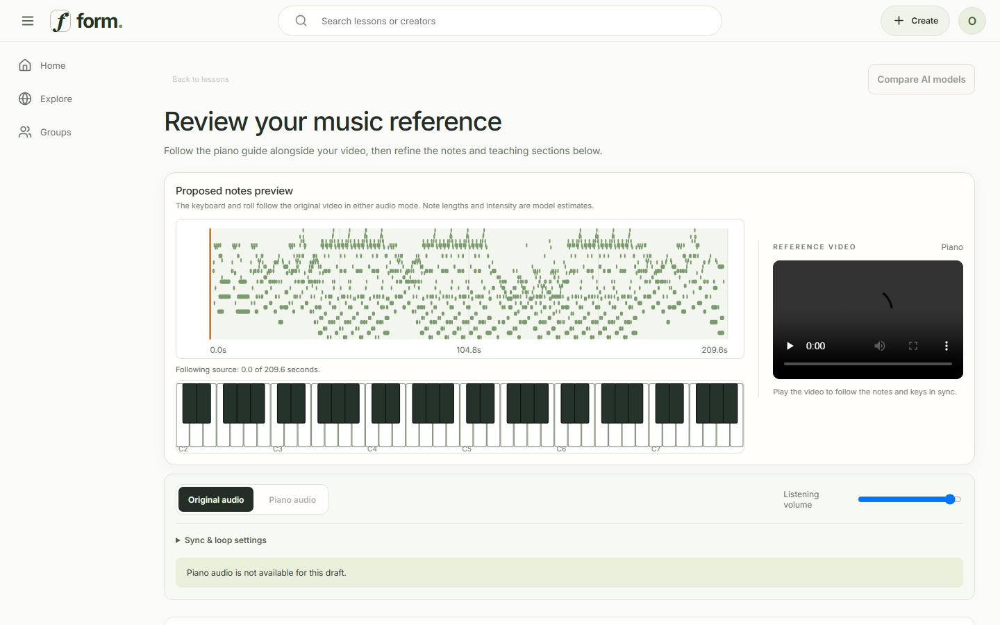
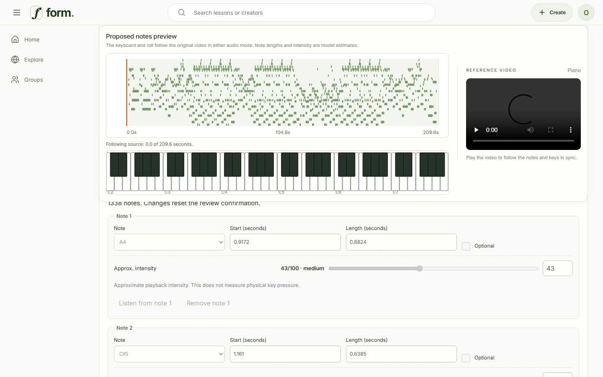

# Piano correction workspace — Phase 1 submission

Baseline audit and safe edit contracts.

| | |
| --- | --- |
| Prepared | 13 November 2026 |
| Phase | **1 — Baseline audit and safe edit contracts** |
| Code audited | `ef4dfb6` — *Checkpoint piano implementation and correction workspace plans* (branch `baseline/piano-correction-2026-11-13`) |
| Submission branch | `phase1/piano-workspace-audit` |
| Revision | **Follow-up after CHANGES REQUIRED** — documentation and evidence only; no product code, no API, no UI |
| Review record | [`piano-workspace-phase-01-review.md`](piano-workspace-phase-01-review.md) |
| Next phase | **Not started** (Phase 2 has not begun) |

This revision answers the reviewer's R1–R5 corrections and the non-blocking evidence wording. The findings of the original submission stand; what changed is that every reproduction now runs from this committed location, the contracts are precise, and the evidence is tracked rather than local.

---

## 0. Corrections in this revision

| Review item | Correction |
| --- | --- |
| **R1** Scripts unreproducible; paths disagreed with the instructions; raw logs absent | All scripts resolve the repository root explicitly (`scripts/lib/paths.ts`, `scripts/lib/paths.py`), take `--input`/`--out`, and default to a scratch directory. A tracked synthetic fixture (`--fixture`) runs every audit with no services. `fetch-draft-json.py` documents the real-data path and fails with a prerequisite message rather than a path error. Raw evidence is committed as `.txt` under `logs/`, and the capture scripts read credentials from the environment. §13 lists the exact commands and their results. |
| **R2** Identity and scope rules contradicted the permitted many-to-one mapping; destructive `replace` branch; tie semantics | §9.1 states the many-to-one rules with one valid and two invalid examples. The `overlap: 'replace'` branch is removed: written overlap and insertion reject without mutation. Tie/untie are **not available** in Phase 2; a performance-scoped `MergeOccurrences` is specified as deferred so D4 cannot return under a new name. §9.4. |
| **R3** Accidentals conflated with respelling; nullable legacy fields unspecified | §9.4 separates `ApplyAccidental` (changes sounding pitch, letter-based) from `Respell` (preserves sounding pitch and audio identity), with the three required examples. §9.5 defines `duration: null` and `velocity: null` as unknown-but-preserved, with display defaults kept out of persisted truth. |
| **R4** Alignment residual mislabelled; internal gaps and inverse policy undefined | §9.3 rewrites alignment as a continuous piecewise map over timed and held passages, states which quantity is measured, defines the inverse policy on held intervals, the anchor reference frame and the offset interaction, and the estimated/one-anchor/no-anchor cases. The 26/52 ms figure is relabelled a quantisation residual, not alignment accuracy. |
| **R5** “Carry notation forward” could preserve stale notation | §9.6 replaces it with a validation-gated policy: retain only when the stored notation still validates against the submitted performance; otherwise reject with an explicit reconciliation error and offer a reported regeneration. A v2 document is never posted to the v1 validator. |

Non-blocking wording corrections: the added duration is now stated as **+960 ticks = a half note = two quarter-note beats**; the snapshot figure is labelled a serialised-size estimate; §6 is a reproduction matrix with a status and receipt for every claim; the API “live without restart” claim is corrected in §2; credentials are environment-driven and the capture scripts are described as authenticating and generating local evidence only.

---

## 1. Against the Phase 1 acceptance gate

| Acceptance criterion | Result | Where |
| --- | --- | --- |
| Every existing editor surface and save boundary is identified accurately | Seven surfaces (three notation views), four write endpoints, one playback-settings endpoint | §4 |
| Why selecting one occurrence needs an occurrence id | Real-example measurements; the brief's C4 is a fixture because this recording has none | §7 |
| Why moving one chord member cannot reuse an event-wide command | 89 of 180 real chord events hold members with different recorded onsets (max 92.8 ms) | §8 |
| Contracts keep exact seconds separate from score ticks | §9.1–9.2, §9.5 | — |
| Existing failures and access limitations recorded honestly | §5, §11 | — |
| No destructive operation assumed safe | 12 identified: 7 reproduced on the real recording, 3 on constructed fixtures, 2 by static analysis, plus 2 safe controls | §6 |

---

## 2. Environment and access baseline

| Item | Value |
| --- | --- |
| Working tree | `D:\3d_trainer\developement` |
| Web dev server | `http://127.0.0.1:5173` (Vite; proxies `/api` → `127.0.0.1:8001`) |
| API server | `127.0.0.1:8001`, launched by `.local/piano-ui-test-runtime.py` (pid 23820) |
| API reload behaviour | **Not** hot-reloading. The launcher calls `uvicorn.run('apps.api.main:app', host=…, port=8001)` without `reload=True` (`.local/piano-ui-test-runtime.py:31`), so **API code changes require restarting the launcher**. Only the Vite frontend hot-reloads. |
| Database | PostgreSQL `form-saas-postgres-1`, database **`form_ui_test`** (the `.env` default `form` holds no lessons) |
| Account | `owner@ui.test` — disposable local UI-test user; the scripts read `PHASE1_UI_EMAIL` / `PHASE1_UI_PASSWORD` and fall back to this documented local account |
| Browser | Chromium 156 via Playwright, 1440×900 and 390×844 |

The capture scripts authenticate against the local API to generate evidence and screen captures. They do not submit a review, save a revision, or mutate musical data; `fetch-draft-json.py` performs a single `SELECT` and copies the document out of the container.

---

## 3. Real-example baseline (209.594 s / 1,338 notes)

The example named in the brief **is accessible** and was audited directly. Verified through the real API and session cookie (`scripts/check-real-draft.py`, `logs/check-real-draft.txt`):

| Property | Value |
| --- | --- |
| Lesson | `0df28929d427406cb86d9bb5e2dcd35b` — “river flows_full version”, piano |
| Draft | `da6ad51626d4435187a51904e0440068`, status `draft` |
| Duration | **209.594 s** |
| Notes | **1,338** |
| Provenance | Basic Pitch 0.4.0 (ONNX), profile `5014a423…193c` |
| Source video | 18.4 MB `…-source.mp4` |
| Notation | **absent** — no `notation` key; `notation_duration` null on every note |
| Alignment | **absent** — no anchor/passage structure of any kind |
| Playback settings | `null` (no sync offset stored) |
| Passages | one playing span `0 → 209.594`; no explanation span |

### 3.1 Performance shape

| Measurement | Value |
| --- | --- |
| First / last attack | 0.917 s / 207.697 s (1.41 s tail silence) |
| Distinct onsets | 974 |
| Same-onset groups | 285, largest **5** |
| Notes inside chords | 649 of 1,338 |
| Distinct pitches | 28 |
| Most repeated | A5 **171** (75 in chords), A4 **134** (53), A3 **125** (86) |
| Max repeats of one pitch in 2 s | 7 (A5) |
| Same-pitch, same-onset duplicates | 0 |
| Median gap / longest gap | 0.197 s / 3.94 s |
| Recorded length | min 0.083 s, median 0.424 s, max 5.774 s |
| **Middle C (60)** | **0 occurrences** |
| Density | 63.8 notes per 10 s |
| Null duration / null velocity | 0 / 0 |

### 3.2 Tracked synthetic fixture

`fixtures/phase1-draft-fixture.json` — 20 occurrences over 12 s, designed for the cases the recording cannot supply:

- six C4 attacks (MIDI 60): 0.0, 1.0, 1.4, 2.0 (two occurrences at one onset) and 9.5 s;
- a **same-pitch, same-onset pair** (C4 at 2.0 s) for F1/F2;
- a **three-way overlap** at 0.5 s (durations 0.2 / 0.4 / 1.2) for the third-voice case;
- an **arpeggiated chord** (4.000 / 4.045 / 4.090 s) for chord-member independence;
- an **explanation gap** in the spans (6.5–9.0 s, `kind: explanation`);
- one `duration: null` and one `velocity: null` occurrence for legacy handling;
- one long bass note (4.0 s) for tie/segment behaviour.

The fixture passes the server validator unchanged (`logs/validate-notation-fixture.txt`), so it is a legal document, not a malformed stub.

### 3.3 The current review page, measured

`scripts/capture-review.py`, `scripts/capture-forms.py` → `measurements.json`, `captures/`.

| Measurement | 1440×900 | 390×844 |
| --- | --- | --- |
| Note forms mounted | 50 per page, **27 pages** | 50 per page, 27 pages |
| Page height | **15,075 px** | **23,363 px** |
| Note form height | 253 px each (12,650 px per page) | 253 px |
| Piano roll | 817 × 200 px for the whole clip | same |
| Roll scale | **3.9 px per second** | 3.9 px/s |
| Horizontal page overflow | none | none |
| `<video>` elements | 1 | 1 |
| Console errors | 0 | 0 |

A 10-second window at a readable scale needs roughly 76 px/s — about **20× the current density**. Every note is a 3–6 px mark.





Observation, recorded without conclusion: `GET /api/lessons/summaries` returned an empty list for this owner, although the draft is reachable by URL. Phase 7 must not assume the library route exists for this fixture.

---

## 4. Surfaces and save boundaries

### 4.1 Editing surfaces

| Surface | File | Current shape | Owns a video? | Selection | History |
| --- | --- | --- | --- | --- | --- |
| Draft review | [`MusicDraftReview.tsx`](../../apps/web/src/music/MusicDraftReview.tsx) | Whole-clip preview, one video, audio mode, 50 note fieldsets per page, title/policy/sections, verification panel | Yes (single `<video>`) | verification finding only, not shared with the forms | none |
| Clip preview | [`DraftNotePreview.tsx`](../../apps/web/src/music/DraftNotePreview.tsx) | Fixed-aspect roll (760-unit viewBox) + keyboard, driven by the parent's video clock (rAF while playing, media events while paused) | No — reads the parent `sourceRef` | highlight ids from findings | none |
| Notation editor | [`NotationEditor.tsx`](../../apps/web/src/music/notation/NotationEditor.tsx) | Score + roll + keyboard + inspector + duration/accidental/tie toolbars | **Yes** — its own `<video>` (:340-345) | one logical note | local `past`/`future` full-document snapshots, max 80 (:66-67, :128) |
| Sheet strip | [`SheetMusic.tsx`](../../apps/web/src/music/notation/SheetMusic.tsx) | One continuous SVG, fixed 300 px per measure, no playhead, no virtualisation | No | logical note id | — |
| Piano roll | [`PianoRoll.tsx`](../../apps/web/src/music/notation/PianoRoll.tsx) | Fixed 760 px viewBox; whole clip in one viewport; drag = move/resize/pitch | No | logical note id | — |
| Keyboard | [`KeyboardEditor.tsx`](../../apps/web/src/music/notation/KeyboardEditor.tsx) | Three-octave audition/edit keys | No | by pitch only | — |
| Reviewed host | [`MusicLessonEditor.tsx`](../../apps/web/src/music/MusicLessonEditor.tsx) | Loads the reviewed reference, keeps a duplicate `notes` array beside the notation document (:86-91), saves a revision | No (passes a URL down) | — | — |

### 4.2 Save boundaries

| Boundary | Endpoint | Notation? | Alignment? | Idempotency |
| --- | --- | --- | --- | --- |
| Initial draft review | `POST /music-draft/review` — [`music_review.py:66`](../../apps/api/music_review.py#L66) | **No** (`ReviewMusic` :44-56; reference document :127-136) | **No** | request SHA-256; identical retry returns the existing revision, different payload 409 |
| Reviewed revision | `POST /music-revision` — [`music_edit.py:45`](../../apps/api/music_edit.py#L45) | **Yes**, optional, validated (:94-98) | **No** | request SHA-256 per base revision |
| Playback / sync offset | `PATCH /music-draft/playback` — [`lessons.py:375`](../../apps/api/lessons.py#L375) | n/a | n/a | revision counter, 409 on mismatch |
| Verification decisions | `POST …/verification-decision`, `…/corrections/rollback` | n/a | n/a | state token |

### 4.3 Validation already available

[`music_notation.py`](../../apps/api/music_notation.py) enforces version, subject, duration equality, ppq, tempo mode, contiguous measures, grid, no same-voice overlap (:196-200), chord pitch uniqueness, spelling↔pitch agreement, performance-link existence, and an exact performance/event match on onset, pitch, duration, velocity and optional (:42-77).

Against real data (`logs/validate-notation-real.txt`):

```
events=1338 notation_events=1146 duration=209.594
builder_output: ACCEPTED
after_one_pitch_edit: REFUSED: A notation performance pitch does not match the reviewed event.
```

The validator is a usable integrity net for Phase 5. Its limit: it checks notation against *submitted* events, so a command that mutates both incorrectly is not caught.

---

## 5. Test baseline

Both suites were rerun for this revision. Logs are tracked.

| Suite | Command | Result | Log |
| --- | --- | --- | --- |
| Web | `cd apps/web; npm test` | **339 passed, 0 failed** (5.7 s) | `logs/web-tests.txt` |
| API (full) | `.venv-saas\Scripts\python.exe -m pytest tests/api -q` | **836 passed, 2 skipped, 1 failed** (7 m 29 s) | `logs/pytest-api-full-2026-11-13.txt` |
| API (review/notation/revision subset) | `pytest tests/api/test_music_{review,edit,contract,playback_settings,draft_handoff}.py -q` | **24 passed** (32.4 s) | `logs/pytest-api-music-subset.txt` |

The single API failure is environmental, not a regression:

```
tests/api/test_piano_expression.py::test_audio_identity_is_measured_and_mismatches_rejected
ModuleNotFoundError: No module named 'soundfile'
```

`soundfile` 0.14.0 exists in `.venv-music` but not `.venv-saas` (the only environment with FastAPI). With `.venv-music` site-packages on `PYTHONPATH`, the identical test passes in 2.11 s. The reviewer independently confirmed the same log; the full-suite number remains developer-reported.

Not covered by either suite: scroll/viewport behaviour, zoom, linked scrolling, playhead geometry, pointer cancellation, drag thresholds, notation or alignment in save payloads, persistence round-trips. `tests/music-engine/notation.test.ts:58-75` currently *asserts* the destructive overwrite (D1), so Phase 2 must change that test with the behaviour.

---

## 6. Findings and reproduction matrix

Every outcome below was produced by `scripts/audit-destructive.ts`; the machine-readable form is `audit-matrix-real.json` (real draft) and `audit-matrix-fixture.json` (fixture). Logs: `logs/audit-destructive-real.txt`, `logs/audit-destructive-fixture.txt`.

| # | Behaviour | Status | Receipt |
| --- | --- | --- | --- |
| D1 | Written-duration command deletes neighbouring occurrences | **reproduced-real** | `ev-treble-1-1080-0-bp-1` 600→1,560 ticks (**+960 = a half note = two quarter-note beats**); performance **1,338 → 1,334**; the neighbour occurrence and three further notes disappeared |
| D2 | Event move rewrites every chord member to one tempo-derived onset | **reproduced-real** | `ev-treble-1-2160-3-bp-5`: distinct recorded onsets **2 → 1** after a one-sixteenth move |
| D3 | Free-time nudge is snapped to the 16th grid | **reproduced-real** | requested 0.9272 s, only 1,080 ticks passable, stored 0.9310 s (net **+0.0138 s**; **3.8 ms** from the request). The achievable step is one grid unit (≈103 ms). On the fixture the same request nets 0.0000 s, i.e. genuinely rounded away. |
| D4 | Tie deletes the second attack and rewrites recorded length | **reproduced-real** | `ev-treble-1-3360-6-bp-10`: 0.9404 s → 1.0345 s (tempo-derived), 1 occurrence absorbed, `untieLast` does not restore it |
| D5 | Insert silently replaces the note it lands on | **reproduced-real** | inserting at 1,080 ticks removed `bp-1` (0.917 s); total unchanged (1,338 → 1,338) |
| D6 | Same-pitch, same-onset occurrences lose their mapping | **constructed-fixture** | two occurrences → one logical note linked to `dup-a` only; the other is unmapped and unselectable |
| D7 | A third overlapping voice is merged or truncates the previous event | **constructed-fixture** | three same-onset groups → 2 events, 1 shortened below a quarter note, no report |
| D8 | No-op commands return a new document | **reproduced-real** | `respellAccidental(natural)` and `changeStaff(same)` return new objects; `changePitch(same)` correctly returns the original |
| D9 | Generated-rest Delete inserts an explicit rest | **static-analysis** | generated rests carry no event id, so the destructive branch is unreachable and the handler falls through to `insertRest` (`NotationEditor.tsx:268-274`); a React handler, not a package command |
| D10 | Every command rebuilds all segments, ties and rests | **reproduced-real (measured)** | 10 edits in 358 ms (**36 ms each**), each regenerating **2,335 segments, 740 ties, 592 generated rests**; serialised document **1.5 MB** |
| D11 | A logical note with several occurrences is edited as a whole | **constructed-fixture** | one logical note linked to `m-a` (1.0 s) and `m-b` (3.0 s); one `changePitch` changed both; no split or rejection path |
| D12 | Reviewed editor ignores the sync offset | **static-analysis** | `MusicLessonEditor` passes only a video URL; the roll draws raw onsets while the playhead is video time. Measuring needs a reviewed revision with a non-zero offset, absent locally |
| C1 | Delete one chord member leaves the rest intact | **safe-control** | deleting pitch 61 kept pitch 80 at its recorded 0.3264 s |
| C2 | Pitch change on one chord member leaves the rest intact | **safe-control** | neighbour pitch, onset and length unchanged |

The two behaviours that cannot be executed from a package command (D9, D12) are marked static rather than claimed as reproductions. The two safe controls are included so the matrix distinguishes “destructive” from “already correct”.

Cost and size figures:

| Measurement | Value |
| --- | --- |
| Notation build, 1,338 notes | 45 ms |
| Ten sequential pitch edits (real) | 358 ms, 36 ms each |
| Serialised notation document | 1.5 MB |
| 80-snapshot history, **serialised-size estimate** | ≈120 MB (JSON size × 80; not a measured heap) |

---

## 7. Why an occurrence needs its own id

| Selector | Why it fails |
| --- | --- |
| Pitch alone | A5 occurs **171 times** (75 inside chords); up to **7 A5 attacks in one 2 s window** |
| Pitch + time window | Still ambiguous at that density; any tolerance wide enough to catch one also catches its neighbour in a repeated-note passage |
| Array index / event id | Broken by insert/delete/move; event ids embed staff/voice/start (`build.ts:122-125`), so rhythmic edits re-key them |

The model already has the right handle: the performance occurrence id (`bp-1` … `bp-1338`). What is wrong is that the editor selects a logical note and mutates through it, and that the review page edits by array index (`MusicDraftReview.tsx:127-128`).

Caveats stated plainly:

- The brief's “selecting one C4” is illustrative: **MIDI 60 appears 0 times** in this recording. The C4 case is covered by the fixture (six C4 attacks, two of them at one onset), and real-data checks use A5/A4/A3.
- Occurrence identity is not logical-note identity: the model permits many occurrences per logical note. §9.1 keeps both and makes scope explicit.

---

## 8. Why a chord member cannot reuse an event-wide command

A `NotationEvent` is a **notational** container: notes sharing staff, voice, quantised start and quantised written duration (`build.ts:70-87`). It is not an occurrence group. On the real clip (`logs/chord-spread-real.txt`):

| Measurement | Value |
| --- | --- |
| Chord events (≥2 notes) | 180 |
| Members have **different recorded onsets** | **89 (49%)** |
| Largest spread inside one event | **92.8 ms** |
| Median spread | 11.6 ms |
| Members have different recorded durations | **172 (96%)** |

So `moveEvent` — the only onset command the roll exposes — collapses a stagger the performer actually played (D2), and `changeDuration` can delete the neighbours behind it (D1). Pitch edits are already per-note, the one safe axis today.

---

## 9. Contracts

### 9.1 Identity, ownership and scope

**Rules**

1. Every sounding performance occurrence belongs to **exactly one** logical note.
2. Every sounding logical note owns **one or more** occurrences.
3. Several occurrences may map to one logical note — this is **many-to-one**, not injective.
4. No occurrence may be owned by two logical notes (duplicate ownership).
5. No occurrence may be absent from the map while present in `performance` (missing ownership).
6. Forward and reverse mappings must agree: rebuilding `performance_map` from the notes yields the same object.
7. Rests own no occurrences and have no logical note.
8. Chord pitch uniqueness within an event; at most two voices per staff.
9. Ids are stable and never position-derived; segments are derived and never identity.

**Valid many-to-one example**

```json
{
  "performance": [{"id": "bp-1", "onset": 1.0}, {"id": "bp-2", "onset": 3.0}],
  "events": [{"id": "ev-1", "notes": [{"id": "n-1", "pitch": 60, "performance_ids": ["bp-1", "bp-2"]}]}],
  "performance_map": {"bp-1": "n-1", "bp-2": "n-1"}
}
```

**Invalid: duplicate ownership** — `bp-1` appears in two logical notes, or the forward map disagrees with the reverse index.

```json
{
  "events": [
    {"id": "ev-1", "notes": [{"id": "n-1", "performance_ids": ["bp-1"]}]},
    {"id": "ev-2", "notes": [{"id": "n-2", "performance_ids": ["bp-1"]}]}
  ],
  "performance_map": {"bp-1": "n-1"}
}
```

**Invalid: missing ownership** — `bp-2` exists in `performance` but is in no note's `performance_ids` and has no `performance_map` entry. This is what D6 and the current builder produce.

**Scope.** Every command declares `scope: 'occurrence' | 'logical' | 'event'`. The default for pitch/onset/recorded-length/velocity is `occurrence`. If a logical note has several occurrences and an occurrence edit would make them diverge, the command **splits** the logical note (new id, same event) or splits the event into an available voice; if neither is representable it **rejects** with `MultiOccurrenceScope`. It never edits the repetitions implicitly (D11).

### 9.2 Time

| Quantity | Unit | Canonical | Rule |
| --- | --- | --- | --- |
| `performance.onset`, `performance.duration` | seconds | **Yes** | exact; never recomputed from ticks; never implicitly snapped |
| `events[].start/duration`, `segments` | ticks (ppq 480, grid 120) | No | written interpretation only |
| `playback.sync_offset_seconds` | seconds, ±10 | Yes (playback setting) | applied once at render/seek, never in notation |
| Display / playhead | seconds | No | `effective = stored + offset`, clamped for display only |

Bounds: `0 ≤ stored_onset`, `onset + recorded_duration ≤ duration`; written `ticks % 120 == 0`, `duration ≥ 120`, `start + duration ≤ last measure end`. Out-of-bounds edits reject; a drag preview clamps but never writes outside the range. Snap is applied only when the user enabled it — never inside the roll→tick conversion as today.

### 9.3 Alignment

**What is measured, and what is not.** The reported 26 ms mean / 52 ms maximum is the difference between performance onsets and the score ticks produced by quantising *the same* data. It is a **quantisation residual**, not independent alignment accuracy and not measured playback drift. Nothing here proves the tempo map is musically right. Phase 4 measures three separate things: (a) continuity of the interpolated cursor at frame rate; (b) activation of occurrences at their exact recorded intervals; (c) alignment error against an **annotated fixture** with known beat times. Beating the circular residual is not a success criterion. (A 103 ms grid does not itself turn `tick = seconds / secondsPerTick` into a step; that conversion is continuous. What is stepped is a nearest-event lookup, which must be labelled as such if it is ever used.)

**Representation.** Strictly increasing anchor pairs cannot represent an internal explanation gap, because the score must hold while time advances. Alignment is therefore a contiguous list of passages:

```ts
type TimedPassage = {kind: 'timed'; source_seconds: [number, number]; ticks: [number, number]};
type HeldPassage  = {kind: 'held';  source_seconds: [number, number]; tick: number};

type Alignment = {
  alignment_version: 1;
  mode: 'estimated' | 'anchored';
  basis: 'tempo' | 'passages';
  passages: (TimedPassage | HeldPassage)[];   // contiguous, ordered, covering 0..duration
};
```

Invariants: passages tile `[0, duration]` without gaps or overlaps; ticks are non-decreasing across the list; a `timed` passage has `ticks[1] > ticks[0]`; a `held` passage has a single tick; `mode: 'anchored'` requires at least one timed passage with a non-zero tick span.

**Mapping.** Within a timed passage `tick = k0 + (seconds − s0) · (k1 − k0)/(s1 − s0)` — continuous, strictly increasing. Within a held passage the tick is constant.

**Inverse policy.** `secondsToTick` is defined everywhere. `tickToSeconds` is unique on timed passages. For a tick that exists only inside a held passage, the inverse returns the **start** of the hold: seeking to such a tick lands on the previous valid boundary, and the next timed passage resumes from there. The pair is therefore *not* claimed to be globally mutually invertible; the policy is fixed, documented and testable (F11).

**Estimated and degenerate cases**

- *No anchors, `basis: 'tempo'`*: one timed passage over the whole clip at the estimated tempo; `mode: 'estimated'`; UI shows “Score alignment estimated”.
- *One anchor*: pins one point; slope elsewhere comes from tempo; still `estimated` until a second, later anchor exists. A single anchor never changes the mode.
- *Anchors*: `SetAlignmentAnchor` inserts a timed passage boundary; anchors that would reverse time or score order are rejected. Chord members on one tick share one anchor.

**Reference frame and the offset.** Passages are stored in **performance seconds**, the same frame as `performance.onset`, and are unaffected by `sync_offset_seconds`. Rendering and seeking convert once: `effective = stored + offset`. Changing the offset never rewrites passages or notes, and the score is never shifted twice.

**Spans.** `spans` remain the authored playing/explanation segments. An `explanation` span becomes a held passage at the tick reached when the preceding timed passage ends; a `playing` span becomes a timed passage. The real clip has one playing span and no explanation span, so the held case is exercised by the fixture only.

### 9.4 Commands

Every command: `(document, args) → Result<document', error>`; validates before mutating; returns the **same identity** on no-op or failure; commits one history entry; resets review confirmation; flags dirty only on a committed change.

**Occurrence scope (default for sound and timing)**

| Command | Arguments | Validation | Failure |
| --- | --- | --- | --- |
| `SetPerformancePitch` | occurrence, pitch, spelling? | 0..127; scope rules of §9.1 | reject without mutation |
| `SetPerformanceOnset` | occurrence, seconds, snap? | bounds; snap only when requested | reject at bounds; never touches the global offset |
| `SetPerformanceDuration` | occurrence, seconds | > 0; onset + seconds ≤ duration | reject |
| `SetVelocity` | occurrence, velocity | 0..1 | reject |
| `DeleteOccurrence` | occurrence | exists | clears selection; removes only that occurrence and its notation link |

**Written scope**

| Command | Arguments | Validation | Failure |
| --- | --- | --- | --- |
| `SetWrittenDuration` | target, ticks, scope | grid; **must not overlap** another written event | `WrittenOverlap{neighbours}` — document unchanged |
| `MoveWrittenStart` | event, ticks | grid; no overlap | reject |
| `ApplyAccidental` | logical note, sharp/flat/natural | must resolve the chosen letter/octave | reject with explanation |
| `Respell` | logical note, target spelling | enharmonic equivalent only | reject |
| `InsertNote` | pitch, seconds, duration, staff?, voice? | duplicate check; overlap rejects; “add to chord” only when the same start/voice event exists and the pitch differs | `AmbiguousInsert` / `DuplicateOccurrence` |
| `DeleteLogicalNote` | logical note | — | removes all linked segments by derivation |

**Overlap policy — deliberately non-destructive.** There is **no** `overlap: 'replace'` branch in Phase 2 and no silent neighbour trimming, in any command. A written edit that would collide is rejected; the user must shorten the neighbour through the neighbour's own command, which states what changes. This is stricter than the original proposal, where a replace option was offered.

**Tie and untie — not available in Phase 2.** A tie in notation implies one sustained sound, while the two occurrences currently carry separate attacks. Implementing it by absorbing the second attack is exactly D4. Therefore:

- `MarkNotationTie` and `Untie` are unavailable, and the UI must say so rather than offer a command that misrepresents playback.
- The deferred replacement is a performance-scoped `MergeOccurrences(target, absorbed)`: keeps the target onset, sets its recorded length to `absorbed.end − target.onset` (exact seconds, clamped to the clip), removes the absorbed occurrence, updates the notation event, one undo step, and reports the length that changed. It is not implemented in Phase 2 and must not be approximated by any other command.

**Accidentals versus respelling** — different operations, never one handler:

| Action | Effect on sounding pitch | Effect on notation | Audio identity |
| --- | --- | --- | --- |
| `ApplyAccidental(note, sharp)` | **changes**: C4 → MIDI 61 | letter kept, accidental `sharp` | invalidates preview |
| `ApplyAccidental(note, flat)` | changes: D4 → 61 | letter kept, accidental `flat` | invalidates preview |
| `ApplyAccidental(note, natural)` | changes: C♯4 → MIDI 60 | letter kept, accidental cleared | invalidates preview |
| `Respell(note, "D♭4")` | **unchanged**: 61 → 61 | new spelling and accidental | no invalidation |

`ApplyAccidental` derives the pitch from the note's letter and octave, then applies ±1 or 0; it is the action the plan describes, not the old “that pitch cannot be written” limitation. Both actions go through occurrence scope, so a multi-occurrence logical note splits or rejects instead of changing repetitions.

### 9.5 Nullable legacy fields

| Field | `null` means | On load | Editing | Display |
| --- | --- | --- | --- | --- |
| `performance.duration` | length never determined | preserved as `null`; never converted to a written value or to zero | `SetPerformanceDuration` may set it | a 0.1 s bar is drawn as a **display default only**; it is never persisted |
| `performance.velocity` | intensity unknown | preserved as `null` | `SetVelocity` may set it; `ClearVelocity` is **unavailable** until legacy nulls are migrated | neutral fill, no velocity-dependent styling |
| `notation_duration` | written value not authored | preserved | written-duration commands may set the event | falls back to the grid-derived value |
| `confidence` | unmeasured | preserved | not editable | not shown as a percentage |

“Unknown length” is not “zero duration”: commands that require a length (tie/merge, alignment passages derived from note ends) refuse until a length exists, naming the occurrence.

### 9.6 Persistence and legacy clients

- `ReviewMusic` gains optional `notation` (Phase 5); `EditMusic` already accepts it. Both validate with the existing `validate_notation` plus a new `validate_alignment` when alignment is present.
- **Legacy omission is validation-gated.** When a client omits notation, the server may retain the stored document **only if** it still validates against the submitted events and the alignment identity is unchanged. Otherwise it rejects with `NotationOutOfDate` (409) naming the mismatched occurrence ids and offering two explicit options: update the client, or regenerate. Regeneration is an explicit, reported action that lists what is lost (spelling, voices, ties, anchors) before it happens.
- Never silently keep stale notation. Never silently regenerate authored work.
- A v2 document (alignment present) must not be posted to the v1-only validator. The server gates on `notation_version`; until Phase 5 supports 2, the workspace harness does not send 2 to the current endpoint, and the existing reviewed-editor and review routes keep their current behaviour.
- Idempotency, verification state tokens, ownership and source hashes are unchanged.
- Audio invalidation keeps comparing performance events only (`music_preview.py:7-12`), so spelling and alignment edits do not invalidate rendered piano audio, while pitch/time edits do.

---

## 10. Fixtures required before Phase 2 acceptance

| Id | Fixture / check | Proves |
| --- | --- | --- |
| F1 | Repeated C4 attacks (fixture has six, two at one onset) plus real A5 repetitions | One occurrence selected and edited; the others untouched |
| F2 | Overlapping same-pitch occurrences | No duplicate ownership; the ambiguity is surfaced |
| F3 | Arpeggiated chord with 90 ms spread (fixture and real) | Per-note onset edits leave the chord's other onsets intact |
| F4 | Written overlap on duration and on move | Rejection without mutation; no neighbour deletion (replaces the test that asserts D1) |
| F5 | Tie request | Unavailable, with an explicit message; `MergeOccurrences` contract test only when implemented |
| F6 | Logical note with two occurrences | Split or `MultiOccurrenceScope`; never both edited |
| F7 | Generated rest selected, Delete pressed | No mutation |
| F8 | Third voice required | Exact rejection, document identity unchanged |
| F9 | 12.347 → 12.357 s with Snap off, save and reload | 10 ms survives; no double offset |
| F10 | Offset ±10 s with notes at both boundaries | One application; invalid stored onsets rejected |
| F11 | Internal explanation gap (fixture spans 6.5–9.0 s) | Cursor holds, resumes, and the inverse returns the hold start |
| F12 | Legacy reference without notation/alignment; legacy v1 client save | Opens marked estimated; stale notation is refused, not retained |
| F13 | No-op command set | Identity-equal document, no dirty flag, no history entry |
| F14 | 20,000 events / 512 measures limits; empty clip | Clear rejection, no partial write |
| F15 | Rubato fixture with annotated beat times | Alignment accuracy measured against ground truth, not a quantisation residual |

---

## 11. Limitations and outstanding checks

- The real draft is reachable, but **not through the library list** for this owner; Phase 7 must verify the normal route rather than assume it.
- No reviewed piano revision exists locally, so the `MusicLessonEditor` save path and D12 are audited statically; Phase 5 needs a reviewed fixture.
- The production `.env` database holds no lessons; only `form_ui_test` does. Evidence runs must name the database.
- The recording has **no C4** and **no explanation passage**; both are covered by fixtures. There is also no annotated beat ground truth, so the audit cannot separate rubato from decode jitter.
- API full suite: one environment-only failure (`soundfile`), verified passing with the music environment on `PYTHONPATH`.
- The 80-snapshot figure is a serialised-size estimate, not a heap measurement.
- D9 and D12 remain static analyses; executing them needs the React handler and a reviewed revision respectively.

**Evidence in Git versus local only.** Tracked: this note, the review record, `fixtures/`, `scripts/`, `logs/*.txt`, `captures/*.png`, `measurements.json`, `audit-matrix-{real,fixture}.json`. Not tracked: the private raw recording, the full draft document dump (`draft-document.json`, 249 KB), the full TAP stream and the intermediate notation JSON (1.5 MB). They are regenerated by the commands in §13 into `.local/phase1-audit/`.

---

## 12. Review record

| Item | Value |
| --- | --- |
| Phase | 1 — Baseline audit and safe edit contracts |
| First submission | `4583e74` — audit documentation and scripts (parent `ef4dfb6`) |
| Review decision | **CHANGES REQUIRED** — see [review note](piano-workspace-phase-01-review.md); D1–D12 confirmed as the target set; duration-overwrite change approved; fixtures approved |
| This revision | Documentation and evidence only: corrected scripts, tracked logs, revised §9 contracts, reproduction matrix, corrected evidence wording |
| Developer summary | R1–R5 addressed as in §0; no product code, API or UI changed; Phase 2 not started |
| Evidence | §3 measurements, `measurements.json`, `audit-matrix-{real,fixture}.json`, `captures/`, `logs/`, `scripts/` (all re-runnable) |
| Deviations / limitations | §11 |
| Blocking findings | None raised by the developer; reviewer to confirm R1–R5 are resolved |
| Next phase authorised | **None** — Phase 2 requires an explicit GO |

---

## 13. Reproducing this revision

All commands run from the repository root. `npx --prefix apps/web tsx …` uses the `tsx` already installed in `apps/web/node_modules`; nothing is copied or relocated.

```powershell
# 1. Fixture-only path: no services, no private data
npx --prefix apps/web tsx docs/qualification/piano-workspace-phase-01/scripts/audit-destructive.ts --fixture
npx --prefix apps/web tsx docs/qualification/piano-workspace-phase-01/scripts/emit-notation.ts --fixture
.\.venv-saas\Scripts\python.exe docs\qualification\piano-workspace-phase-01\scripts\validate-notation.py --fixture
.\.venv-saas\Scripts\python.exe docs\qualification\piano-workspace-phase-01\scripts\analyze-draft.py --fixture

# 2. Real-data path (needs the local stack; read-only)
.\.venv-saas\Scripts\python.exe docs\qualification\piano-workspace-phase-01\scripts\fetch-draft-json.py
npx --prefix apps/web tsx docs/qualification/piano-workspace-phase-01/scripts/audit-destructive.ts
npx --prefix apps/web tsx docs/qualification/piano-workspace-phase-01/scripts/emit-notation.ts
.\.venv-saas\Scripts\python.exe docs\qualification\piano-workspace-phase-01\scripts\validate-notation.py
.\.venv-saas\Scripts\python.exe docs\qualification\piano-workspace-phase-01\scripts\chord-spread.py
.\.venv-saas\Scripts\python.exe docs\qualification\piano-workspace-phase-01\scripts\check-real-draft.py
.\.venv-saas\Scripts\python.exe docs\qualification\piano-workspace-phase-01\scripts\capture-review.py

# 3. Test suites
cd apps/web; npm test; cd ..\..
.\.venv-saas\Scripts\python.exe -m pytest tests/api -q
```

Observed results for this revision (all exit code 0 unless stated):

| Command | Result |
| --- | --- |
| fixture audit | 12 receipts written to `audit-matrix-fixture.json`; D1/D2/D4/D8 reproduced, D6/D7/D11 constructed, C1/C2 safe |
| real audit | 12 receipts written to `audit-matrix-real.json`; D1–D5, D8, D10 reproduced, D6/D7/D11 constructed, D9/D12 static |
| `emit-notation` (real) | 1,146 events, 2,335 segments, 127 measures, 145 BPM |
| `validate-notation` (real) | builder output **ACCEPTED**; one pitch edit **REFUSED** |
| `validate-notation` (fixture) | builder output **ACCEPTED**; one pitch edit **REFUSED** |
| `chord-spread` (real) | 180 chords, 89 with differing onsets, max 92.8 ms, median 11.6 ms |
| `check-real-draft` | 1,338 events, 209.594 s, no notation, no alignment |
| `capture-review` | 50 fieldsets, 27 pages, 15,075 px page, 3.9 px/s, no overflow |
| `npm test` | 339 passed |
| `pytest tests/api` | 836 passed, 2 skipped, 1 env-blocked (targeted subset also green) |

---

## 14. Scope statement

This revision is documentation and evidence only. No component has been extracted, no shared controller or history exists, no selection model has changed, and the review page and note forms are untouched. **Phase 2 has not started** and awaits an explicit GO.
