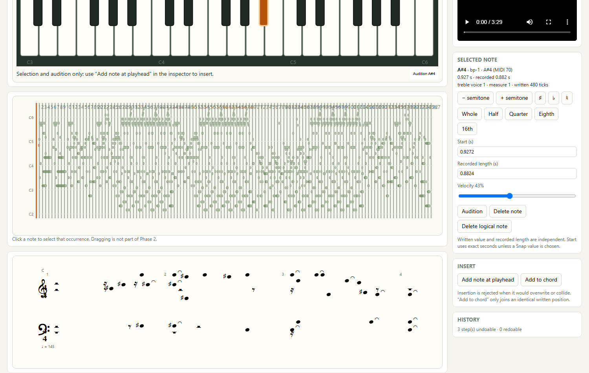

# Piano correction workspace — Phase 2 submission

Unified document, occurrence selection, safe commands and one history.

| | |
| --- | --- |
| Prepared | 13 November 2026 |
| Phase | **2 — Unified document, selection, commands and history** |
| Branch | `phase2/correction-foundation`, created from `28f37ce` (Phase 1 follow-up) |
| Product routes changed | **None.** The review page, note forms, reviewed-lesson editor and API are untouched |
| New harness | `/workspace-harness.html?id=<lesson id>` — an isolated Vite entry, not linked from the app |
| Phase 3 | **Not started** |

---

## 1. What was delivered

| Deliverable from the phase scope | Where |
| --- | --- |
| One working document holding performance, notation and stable links | Existing `NotationDocument`; the controller treats it as the single authority |
| One shared occurrence selection | `CorrectionSelection` + `selectionForOccurrence` in [`packages/music-notation/correction.ts`](../../packages/music-notation/correction.ts); reducer in [`workspace-state.ts`](../../apps/web/src/music/workspace/workspace-state.ts) |
| One history | Same reducer: bounded 100 snapshots of `{document, selection}`, one entry per applied command |
| Editor surfaces usable with external selection/playback | Optional occurrence-selection props added to `PianoRoll`, `SheetMusic`, `KeyboardEditor`; the harness owns the only `<video>` |
| Safe per-occurrence pitch, onset, recorded-length, insert, delete commands | `applyCommand` in `correction.ts`, 11 command types |
| Logical rhythm/spelling commands with explicit scope | `set-written-duration` (`scope: event` / `scope: note`), `apply-accidental`, `respell` |
| Free recorded time separated from beat-snapped time | `set-occurrence-onset` takes exact seconds; snapping happens only when `snapSeconds` is supplied |
| Split chord/mapping structures when required | Split-on-divergence for multi-occurrence logical notes; split-to-free-voice for single-note written changes; explicit rejection otherwise |
| Reject third-voice and ambiguous operations without alteration | `needs-third-voice`, `written-overlap`, `ambiguous-insert`, `duplicate-chord-pitch` |
| Preserve logical ids and authored spelling through unrelated edits | Commands never re-derive ids; pitch changes respell, respell keeps pitch, written edits touch no performance field |
| Minimal isolated developer harness | [`PianoWorkspaceHarness.tsx`](../../apps/web/src/music/workspace/PianoWorkspaceHarness.tsx) + `workspace-harness.html` |

### 1.1 Acceptance gate

| Criterion | Evidence |
| --- | --- |
| Editing one of many repeated pitches changes only the selected occurrence | Unit test + harness: `bp-1` A4 → A#4, status `1 changed · 0 added · 0 removed · 1338 total`; the other 133 A4 attacks are untouched |
| Editing one chord member leaves unrelated members unchanged | Unit test: chord E4+G4 (plus bass C3); changing E4 leaves the neighbour's pitch, onset and recorded length identical |
| A 10 ms onset adjustment is not rounded when Snap is Off | Unit test (`0.01` preserved to 1e-9) + harness field shows `0.9272` for `0.9172 + 0.01` |
| Written duration and recorded duration are independent | Unit test both directions; harness: `Quarter` while recorded length stays `0.8824 s` |
| Undo/redo restores the document and a valid selection; no dangling mappings | Unit tests: undo after edit and after deletion; split keeps `performance_map` complete (2 occurrences, 2 logical notes) |
| Invalid commands, cancelled operations and no-ops do not mutate data or create history | Unit tests: rejection keeps document identity, `past` empty, `dirty` false; no-op reports `unchanged` |
| Existing reviewed-editor behaviour remains compatible or is explicitly isolated | All 339 pre-existing tests still pass; `NotationEditor` and `MusicDraftReview` are unmodified; the review route renders the same 50 forms / 27 pages (capture) |

---

## 2. The command layer

[`packages/music-notation/correction.ts`](../../packages/music-notation/correction.ts) is additive: the Phase 1 destructive helpers in `edit.ts` are left in place for the legacy editor, and the new layer is what the workspace uses.

Every command returns one of:

```ts
{status:'applied', document, label, selection}   // one history entry
{status:'unchanged', label}                        // same identity, no entry
{status:'rejected', code, message}                 // document untouched
```

| Command | Scope | Validates | Rejection codes |
| --- | --- | --- | --- |
| `set-occurrence-pitch` | occurrence | MIDI 0–127, chord pitch uniqueness, optional spelling consistency | `invalid-pitch`, `duplicate-chord-pitch`, `unsupported-spelling` |
| `set-occurrence-onset` | occurrence | finite, ≥ 0, `onset + recorded ≤ clip`; snaps only when asked | `invalid-onset`, `out-of-bounds` |
| `set-occurrence-duration` | occurrence | > 0, inside the clip | `invalid-duration`, `out-of-bounds` |
| `set-occurrence-velocity` | occurrence | 0–1 or null | `invalid-velocity` |
| `set-written-duration` | event or note | sixteenth grid, no same-voice overlap, split to a free voice or reject | `invalid-ticks`, `written-overlap`, `needs-third-voice` |
| `move-written-start` | event | sixteenth grid, no overlap | `invalid-ticks`, `written-overlap` |
| `apply-accidental` | logical note | letter/octave resolved, pitch stays in range | `invalid-pitch` |
| `respell` | logical note | enharmonic equivalent only | `unsupported-spelling` |
| `insert-note` | document | duplicate occurrence, written collision, chord join only when asked | `duplicate-occurrence`, `ambiguous-insert`, `written-overlap`, `duplicate-chord-pitch` |
| `delete-occurrence` | occurrence | exists | `unknown-occurrence` |
| `delete-logical-note` | logical note | exists | `unknown-note` |

### 2.1 Semantics that matter

- **Split, never replicate.** If a logical note owns several occurrences and an occurrence edit would make them diverge, the command splits a new logical note (same event) and edits only the target. The other occurrences keep their pitch, onset and length. Covered by a constructed-document test.
- **No collateral deletion.** Written overlap rejects; there is no neighbour trimming anywhere in this layer. The D1/D5 behaviours remain only in the legacy editor path.
- **Old helpers are not reused.** `removeOverlap`, `moveEvent`, `changeDuration`, `tieToNext` are not called by any new command.
- **Tie is not implemented.** It would have to delete an attack (D4); `MergeOccurrences` stays deferred, as agreed in the Phase 1 review.
- **Unknown values are preserved.** A `duration: null` occurrence can be moved and given a length, but is never treated as zero.
- **Snapping is opt-in.** `set-occurrence-onset` accepts exact seconds; the harness passes a snap value only when the user picked one.

### 2.2 What the layer deliberately does not do

- No alignment or offset handling (Phase 4).
- No persistence call, no dirty-to-server transition, no confirmation reset — the host workflow owns those (Phase 5).
- No gestures: drag preview/cancel belongs to Phase 6. The history contract it must satisfy is already fixed: one `applyCommand` per completed gesture, and no reducer state change during preview.

---

## 3. One document, one selection, one history

[`workspace-state.ts`](../../apps/web/src/music/workspace/workspace-state.ts) is a pure reducer:

- `select` resolves the occurrence against the current document; an unknown id clears the selection and reports it. Selection never creates a history entry or a dirty flag.
- `command` applies once: applied → one snapshot pushed, future cleared, dirty, revision + 1, selection taken from the command's target (kept when the command does not move focus).
- `undo`/`redo` restore `{document, selection}` together and re-validate the selection against the restored document, so a deletion cannot leave a dangling reference.
- Rejected and unchanged commands leave `document` identity unchanged and add nothing.
- `workspaceStatus` never claims a save; it reads “Unsaved changes (not saved — this harness has no save)”.

Surfaces are driven from this state, not from private copies. `PianoRoll` gained `selectedOccurrenceId`/`onSelectOccurrence`; `SheetMusic` highlights by occurrence and selects an occurrence only when the notehead maps exactly one; `KeyboardEditor` gained `onSelectKey` plus host-supplied hint text so it cannot claim editing it does not perform. All three props are optional, which is why the reviewed editor and its tests are unaffected.

---

## 4. The developer harness

```
http://127.0.0.1:5173/workspace-harness.html?id=0df28929d427406cb86d9bb5e2dcd35b
```

- A separate Vite entry (`workspace-harness.html` + `src/workspace-harness.tsx`), never linked from the app shell. The ordinary review route is unchanged and still reachable at `?page=music-review&id=…`.
- Loads the same draft through the same API and builds notation in the browser; it **writes nothing** — there is no save control, and the status line says so.
- One `<video>` for the clip, one playhead feeding keyboard/roll/score, one selection shared by all three, one undo/redo pair.
- Inspector edits: pitch ± semitone, ♯/♭/♮, written value buttons, start (exact seconds, optional snap), recorded length, velocity, audition, delete occurrence, delete logical note, insert at playhead / add to chord.
- A live diff against the loaded document: `changed · added · removed · total`, so a reviewer can see that one edit changed exactly one occurrence of 1,338.

Not in the harness: any edit route from the score or roll by dragging (the surfaces' drag callbacks are wired to no-ops), linked scrolling, alignment authoring, or saving.

---

## 5. Test evidence

| Suite | Command | Result |
| --- | --- | --- |
| Web (full) | `cd apps/web; npm test` | **364 passed, 0 failed** (5.8 s) — 339 pre-existing + 25 new |
| Type check | `cd apps/web; npx tsc --noEmit` | clean |
| Production build (incl. harness entry) | `cd apps/web; npm run build` | success, 5.0 s (pre-existing chunk-size warning only) |
| API | unchanged; no backend file touched | not re-run for this phase |

New tests:

- [`tests/music-engine/correction-commands.test.ts`](../../tests/music-engine/correction-commands.test.ts) — 16 tests: repeated pitch, chord member independence, 10 ms with Snap off, Snap-on rounding, written/recorded independence, written collision rejection, no-op identity, multi-occurrence split, invalid values, out-of-bounds onset, insert collision and add-to-chord, deletion scope, accidental vs respell, selection after a written change, unknown recorded length.
- [`apps/web/tests/workspace-state.test.tsx`](../../apps/web/tests/workspace-state.test.tsx) — 9 tests: selection is not history, unknown selection clears, one entry per applied command, rejected/no-op create nothing, undo/redo restore document and selection, undo after deletion, status honesty, reset.

Browser evidence from the real 1,338-note draft (`harness-result.json`):

```json
{
  "status": "Unsaved changes … | 1 changed · 0 added · 0 removed · 1338 total | Selected bp-1",
  "facts": "A#4 · bp-1 · A#4 (MIDI 70) | 0.927 s · recorded 0.882 s | treble voice 1 · measure 1 · written 480 ticks",
  "start_after_10ms": 0.9272,
  "start_expected": 0.9272,
  "videos": 1,
  "review_forms": 50,
  "review_pages": "Page 1 of 27",
  "console_errors": []
}
```




The reviewed-editor tests (`notation-editor.test.tsx`) and the review page itself are unchanged; the API and `MusicDraftReview` were not edited in this phase.

---

## 6. Deviations and limitations

| Item | Status |
| --- | --- |
| `NotationEditor` still owns its `<video>` | **Deferred by design.** The surfaces now accept external selection, and the harness proves a single-video composition; migrating the reviewed editor is done when the workspace becomes the layout (Phase 3/6). Until then its editing path still uses the legacy commands, including the destructive ones. This is the “explicitly isolated until migration” option in the acceptance gate, not a claim that migration happened. |
| The harness is not a route in the app router | Deliberate isolation: a separate Vite entry cannot leak into the review workflow or change its URL handling. |
| Roll and score still compress the whole clip | Phase 3. The harness inherits the current rendering; the dense measure labels and tiny notes in the captures are the known Phase 3 problem, not a Phase 2 regression. |
| No drag gestures, preview or cancel | Phase 6. Command boundaries are ready for them (one command per gesture). |
| No persistence, recovery or alignment | Phases 4–5. Status text is explicit that nothing is saved. |
| Harness insertion UI is minimal | One button at the playhead plus add-to-chord; the command itself validates and rejects collisions, and is unit tested. |

---

## 7. Review record

| Item | Value |
| --- | --- |
| Phase | 2 — Unified document, selection, commands and history |
| Submitted code | Branch `phase2/correction-foundation` from `28f37ce`; see the commit that adds this note |
| Developer summary | Added the occurrence command layer, pure workspace reducer (one document/selection/history), occurrence selection on the three surfaces, and an isolated harness; no product route, API or existing editor changed |
| Evidence | §5, `harness-result.json`, three captures, `logs/web-tests.txt` |
| Deviations / limitations | §6 |
| Review decision | **NOT REVIEWED** |
| Next phase authorised | **None** — Phase 3 requires an explicit GO |

### Reproducing

```powershell
# 1. Tests and static checks
cd apps/web
npm test            # 364 pass
npx tsc --noEmit    # clean
npm run build       # includes the harness entry

# 2. Harness (dev servers running)
#    http://127.0.0.1:5173/workspace-harness.html?id=0df28929d427406cb86d9bb5e2dcd35b
#    Select a note, change the pitch, set Start to +0.01 s, choose Quarter, then Undo.

# 3. Review route unchanged
#    http://127.0.0.1:5173/?page=music-review&id=0df28929d427406cb86d9bb5e2dcd35b
```

---

## 8. Reviewer clarifications retained for later phases

From the Phase 1 follow-up review ([note](piano-workspace-phase-01-followup-review.md)); none block this phase:

- Alignment passage joins must be **continuous in score ticks** unless a documented discontinuity is intended; non-decreasing ticks alone would permit jumps. Boundary ownership and inverse priority need one owner: a held tick also exists at the adjacent timed endpoints.
- With a non-zero global offset, video time outside the stored mapping domain needs an explicit boundary hold/clamp policy, and the offset must never be applied twice.
- Fixture save/reload, API compatibility and live cursor tests belong to the persistence and playback gates; this phase demonstrates command-level and selection behaviour only.
- The audit validator in `docs/qualification/piano-workspace-phase-01/scripts/validate-notation.py` prints ACCEPTED/REFUSED but does not fail its process on an unexpected result. Before it is used as an automated acceptance check, expected outcomes must become assertions.

---

## 9. Scope statement

Phase 2 is complete as scoped and nothing beyond it has been started: no layout work, no linked scrolling, no alignment authoring, no draft persistence, and no replacement of the review page or its note forms. Phase 3 awaits an explicit GO.
