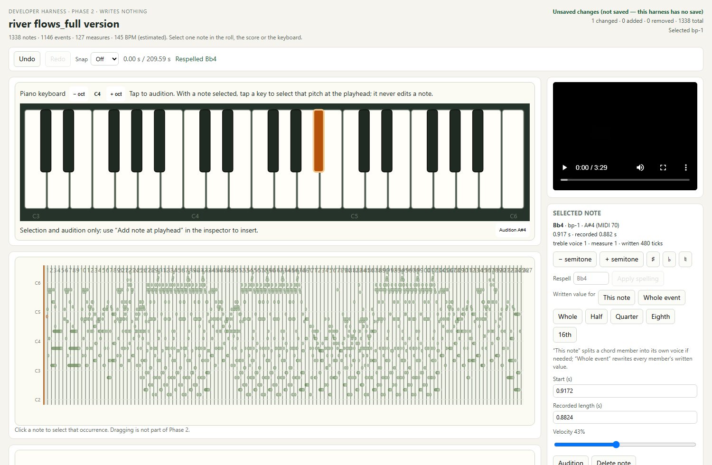

# Piano correction workspace — Phase 2 submission

Unified document, occurrence selection, safe commands and one history.

| | |
| --- | --- |
| Prepared | 13 November 2026 |
| Phase | **2 — Unified document, selection, commands and history** |
| Branch | `phase2/correction-foundation` |
| Revision | **Correction 2 after the follow-up review** (F1–F3 plus the non-blocking evidence fixes) |
| Product routes changed | **None.** Review page, note forms, reviewed-lesson editor and API are untouched |
| Harness | `/workspace-harness.html?id=<lesson id>` — isolated Vite entry, never linked from the app |
| Phase 3 | **Not started** |

This revision fixes the three foundation defects in the follow-up review and the non-blocking evidence issues. The shape is unchanged: one document, one occurrence selection, a patched history with per-command selection, an isolated harness, and the legacy reviewed editor left untouched.

---

## 0. Corrections in this revision

| Review item | Fix | Evidence |
| --- | --- | --- |
| **F1** Note scope with an event target changed the whole chord | The command type is now a union of `{target: eventId, scope: 'event'}` and `{target: logicalNoteId, scope: 'note'}`; the runtime re-checks the pairing and rejects a mismatch with `invalid-scope` before any split or mutation | Tests: `scope: 'note'` + event target → `rejected`/`invalid-scope`, both chord members keep 360 ticks; the reverse pairing rejects too |
| **F2** A same-pitch command overwrote authored spelling | When the sounding pitch is unchanged and no spelling is supplied, the command returns `unchanged` before deriving any default spelling, so `D♭4` stays `D♭4`; an explicit different spelling still applies through the validated split-or-reject path | Tests: respell to `Db4`, then `set-occurrence-pitch` 61 → `unchanged`, spelling preserved (single and multi-mapped); reducer adds no history and stays clean |
| **F3** Patch history dropped selection restoration | Each history entry stores `selectionBefore`/`selectionAfter`; undo restores the pre-command selection and redo restores the post-command one, both revalidated against the restored document | Tests: undo after deleting the selected note restores the note **and** its selection; undo after insertion restores the pre-insert selection; undo after a split restores the original logical note id; an explicit selection change after the edit does not become the undo target |

Non-blocking corrections:

- **Retention accounting.** `historyBytes` now counts undo **and** redo patches, in UTF-8 bytes (`TextEncoder`), not UTF-16 code units; `historySummary` reports `undoBytes`/`redoBytes`/`totalBytes`. The harness now shows `0 undo step(s) · 3 redoable · 2.1 KB retained (0 B undo + 2111 B redo)` instead of claiming 0 KB with a live redo queue. The 4 MB budget applies to the combined retention; trimming drops oldest entries and always keeps at least one, so a single patch larger than the budget is retained rather than silently discarded.
- **Reviewer reproducer updated** to the occurrence-scoped accidental API. It now asserts that the selected second occurrence changes **and** the first does not; it still reports 8/8 PASS.
- **No realignment claim.** Onset/recorded-length edits keep the many-to-one mapping deliberately, but the handoff makes no claim that the written score position has been realigned; note activation versus written position is explicit Phase 4 work.

### 0.1 Previously accepted corrections (unchanged by this revision)

R1 atomic written-duration split · R2 occurrence-scoped accidentals/respelling · R3 complete no-op equality and split-or-reject · R4 typed input validation, structural `documentProblem`, refresh errors as rejections · R5 patch history instead of document snapshots · R6 selection preservation and truthful dirty state. The prior review verified these; this revision only tightens F1–F3 around them.

---

## 1. What the phase delivers

| Deliverable | Where |
| --- | --- |
| One working document (performance + notation + stable links) | `NotationDocument`, owned by the workspace state |
| One shared occurrence selection | `CorrectionSelection` + `selectionForOccurrence`; the reducer revalidates on every change |
| One history | Patch entries with selection on both sides, bounded by count and UTF-8 bytes |
| Surfaces usable with external selection/playback | Optional occurrence props on `PianoRoll`, `SheetMusic`, `KeyboardEditor`; the harness owns the only video |
| Occurrence pitch/onset/recorded-length/velocity/insert/delete | `applyCommand` (11 command types) |
| Written rhythm and spelling with explicit scope | `set-written-duration` (typed target/scope pairing), `apply-accidental`, `respell` |
| Free time vs beat-snapped time | Exact seconds by default; snapping only with a valid interval |
| Split or reject multi-mapping/chord changes | Split-on-divergence, split-to-voice, or typed rejection |
| Isolated harness | `workspace-harness.html` + `PianoWorkspaceHarness.tsx` |

---

## 2. The command layer

[`packages/music-notation/correction.ts`](../../packages/music-notation/correction.ts) is additive; the legacy helpers are untouched.

Every command returns `applied` (with an optional selection override), `unchanged`, or `rejected`. Applied results are refreshed **and validated**: `documentProblem` checks ids, ownership, grid, voice overlap, chord pitch uniqueness, occurrence completeness and `performance_map` agreement; a refresh error becomes `document-invalid` instead of an exception.

| Command | Scope / target | Validates |
| --- | --- | --- |
| `set-occurrence-pitch` | occurrence | MIDI range, spelling↔pitch, chord pitch uniqueness, **authored spelling preserved when the pitch is unchanged** |
| `set-occurrence-onset` | occurrence | finite ≥ 0, clip bounds, snap interval finite and > 0 |
| `set-occurrence-duration` | occurrence | > 0, clip bounds |
| `set-occurrence-velocity` | occurrence | 0–1 or null |
| `set-written-duration` | **event target + `scope: 'event'`**, or **logical-note target + `scope: 'note'`** | pairing enforced by type and runtime, sixteenth grid, no same-voice overlap, no-op before split, free voice or `needs-third-voice` |
| `move-written-start` | event | grid, no overlap |
| `apply-accidental` | occurrence | letter/octave resolved, range, split-or-reject |
| `respell` | occurrence | enharmonic equivalent only, split-or-reject |
| `insert-note` | document | pitch/seconds/ticks/staff/voice, duplicate occurrence, collision, measure limit, chord join only when asked |
| `delete-occurrence` | occurrence | exists |
| `delete-logical-note` | logical note | exists |

Rejection codes: `invalid-pitch`, `invalid-velocity`, `invalid-onset`, `invalid-duration`, `invalid-ticks`, `invalid-scope`, `out-of-bounds`, `written-overlap`, `needs-third-voice`, `duplicate-chord-pitch`, `duplicate-occurrence`, `ambiguous-insert`, `unsupported-spelling`, `too-many-occurrences`, `document-invalid`.

### 2.1 Semantics

- **Scope and target cannot disagree.** A note-scoped written change must name a logical note; a whole-event change must name an event. Ambiguity rejects instead of falling through to the whole event.
- **Authored spelling survives a same-key press.** Pressing the key a note already has is `unchanged` and keeps a corrected `D♭` or `F♭`; only an explicit spelling request changes notation at the same pitch, and a changed pitch derives its default spelling from the key.
- **Occurrence-exact.** Pitch, onset, recorded length, velocity, accidentals and respelling all take an occurrence id.
- **Split, never replicate.** Divergence detaches the occurrence (same event when its pitch is free there, else an available voice); if neither is representable it rejects and leaves the document untouched.
- **No-op before side effects.** Equal pitch + spelling is `unchanged` even when no voice is free; equal written value is `unchanged` before any split.
- **No collateral deletion.** Written overlap rejects; no neighbour trimming exists in this layer.
- **Tie/merge remains unavailable** (`MergeOccurrences` deferred); untie is not offered.
- **Unknown values preserved.** `duration: null` can be moved and given a length, never treated as zero.
- **Snapping is opt-in and validated.**
- **Performance-only edits make no score claim.** Changing an onset or recorded length updates exact seconds and keeps the mapping; it does not realign the written position, and the handoff does not claim it does.

---

## 3. One document, one selection, one history

[`workspace-state.ts`](../../apps/web/src/music/workspace/workspace-state.ts) is a pure reducer; [`document-patch.ts`](../../apps/web/src/music/workspace/document-patch.ts) computes and applies patches.

- **Select** resolves the occurrence, records nothing in history and never marks dirty.
- **Command** applies once, stores a patch **plus the selection before and after**, clears redo, sets dirty, and reports what happened.
- **Undo** applies the inverse patch and restores `selectionBefore` (revalidated). When the last entry is undone the loaded document object is restored verbatim and `dirty` becomes false; after eviction that shortcut is disabled.
- **Redo** reapplies the forward patch and restores `selectionAfter`.
- **Retention:** entries are dropped oldest-first when the 500-entry cap or the 4 MB combined UTF-8 byte budget is exceeded; at least one entry is kept. `historyBytes` and `historySummary` count undo **and** redo.

---

## 4. Harness

```
http://127.0.0.1:5173/workspace-harness.html?id=0df28929d427406cb86d9bb5e2dcd35b
```

- Loads the draft through the same API and writes nothing; the status line says so.
- One `<video>`, one playhead, one selection across keyboard, roll and score.
- Inspector: pitch ± semitone, ♯/♭/♮ (occurrence-scoped), respell field, **written-value scope** (“This note” default, “Whole event” labelled with the member count), written-value buttons, exact start with optional Snap, recorded length, velocity, audition, delete occurrence / logical note, insert at playhead / add to chord.
- Live `changed · added · removed · total` diff and a history panel that separates undo and redo retention in bytes.

Captured on the real draft: selecting `bp-1` (A4), changing the written value with “This note” keeps the recorded 0.882 s and reports `0 changed` (a written-only edit touches no occurrence); ♯ makes it A♯4 (MIDI 70); respelling to B♭4 keeps MIDI 70; full undo reports **“No changes · 0 changed · 1338 total”** with the selection still on `bp-1`; the history panel reads **`0 undo step(s) · 3 redoable · 2.1 KB retained (0 B undo + 2111 B redo)`**.




---

## 5. Test and measurement evidence

### 5.1 Suites

| Check | Command | Result |
| --- | --- | --- |
| Web (full) | `cd apps/web; npm test` | **388 passed, 0 failed** (6.2 s) — 339 pre-existing + 49 new |
| Type check | `cd apps/web; node_modules\.bin\tsc --noEmit` | clean |
| Original reviewer reproducer | `node --import ./apps/web/node_modules/tsx/dist/loader.mjs docs/qualification/piano-workspace-phase-02-review-repro.ts` | **8/8 PASS** (updated to the occurrence API) |
| Follow-up reviewer reproducer | `… docs/qualification/piano-workspace-phase-02-followup-repro.ts` | **3/3 PASS** |
| API | unchanged; no backend file touched | not re-run |

New coverage: 30 command tests ([`correction-commands.test.ts`](../../tests/music-engine/correction-commands.test.ts)) including F1 pairings, F2 spelling preservation, R1–R4 and a validity assertion on every applied command; 19 reducer tests ([`workspace-state.test.tsx`](../../apps/web/tests/workspace-state.test.tsx)) including F3 selection restoration, history byte accounting and the patch-size benchmark.

### 5.2 History benchmark — real 1,338-note draft

`scripts/history-benchmark.ts` (result in `history-benchmark.json`):

| Measurement | Value |
| --- | --- |
| Document | 1,577,192 bytes serialised, 1,338 occurrences |
| 50 pitch edits | 1,874 ms (37.5 ms each) |
| Retained patches after the edits | **48,691 UTF-8 bytes** (974 B each) = **3.1 %** of one document |
| Retained after undoing all 50 | **48,691 bytes** — the redo queue is counted, not dropped |
| 50 undos | 1,541 ms (30.8 ms each); document identity restored; `dirty=false` |
| 50 redos | 1,496 ms (29.9 ms each) |

The rejected design (up to 100 full snapshots) would have been roughly 158 MB of serialised-equivalent document data for the same clip. Figures are UTF-8 patch sizes and latency observations, not measured heap.

---

## 6. Deviations and limitations

| Item | Status |
| --- | --- |
| No logical-wide accidental/respell action | Deliberate: the review rejected inferring a target from array order. A future “apply to every occurrence” must be a separate explicit command. |
| Onset/recorded-length edits keep the many-to-one mapping | Accepted for this phase; no claim that the written position has been realigned. Phase 4 owns activation-versus-written-position handling. |
| A single patch larger than the 4 MB budget is kept | The cap drops older entries only; one oversized entry cannot be split, so it is retained rather than silently lost. |
| `NotationEditor` still owns its `<video>` and legacy commands | Isolated by design (accepted in the Phase 1 GO); migration belongs with the Phase 3 layout. |
| Roll and score still compress the whole clip | Phase 3; the dense measure labels are inherited, not introduced. |
| No gestures, persistence, recovery or alignment | Phases 4–6; the harness states that nothing is saved. |
| Undo/redo cost ≈ 31 ms per step at this size | Accepted for Phase 2; revisit if the workspace needs faster stepping. |

---

## 7. Review record

| Item | Value |
| --- | --- |
| Phase | 2 — Unified document, selection, commands and history |
| First submission | `35b27e2` — CHANGES REQUIRED |
| Correction 1 | `a42294c` — R1–R6 fixed; follow-up review verified those and raised F1–F3 |
| This revision | Correction 2: F1 scope/target pairing, F2 authored-spelling preservation, F3 selection restoration; retention accounting and reproducer evidence updated |
| Evidence | `logs/web-tests.txt`, `logs/reviewer-repro.txt`, `logs/reviewer-followup-repro.txt`, `harness-result.json`, `history-benchmark.json`, captures |
| Deviations / limitations | §6 |
| Review decision | **NOT REVIEWED** |
| Next phase authorised | **None** — Phase 3 requires an explicit GO |

### Reproducing

```powershell
cd apps/web
npm test                    # 388 pass
node_modules\.bin\tsc --noEmit

cd ..\..
& 'C:/Program Files/nodejs/node.exe' --import ./apps/web/node_modules/tsx/dist/loader.mjs docs/qualification/piano-workspace-phase-02-review-repro.ts
& 'C:/Program Files/nodejs/node.exe' --import ./apps/web/node_modules/tsx/dist/loader.mjs docs/qualification/piano-workspace-phase-02-followup-repro.ts
npx --prefix apps/web tsx docs/qualification/piano-workspace-phase-02/scripts/history-benchmark.ts

# Harness (dev servers running):
#   http://127.0.0.1:5173/workspace-harness.html?id=0df28929d427406cb86d9bb5e2dcd35b
#   Select a note → “This note” → Quarter → ♯ → respell B♭4 → undo to “No changes”.
```

---

## 8. Reviewer clarifications retained for later phases

- Alignment passage joins must be continuous in score ticks; a held tick also exists at adjacent timed endpoints, so the hold-start inverse policy needs one owner.
- With a non-zero global offset, video time outside the mapped domain needs an explicit hold/clamp policy; never apply the offset twice.
- Fixture save/reload, API compatibility and live cursor tests belong to the persistence and playback gates.
- `docs/qualification/piano-workspace-phase-01/scripts/validate-notation.py` prints ACCEPTED/REFUSED without failing its process; it must assert before being used as an automated check.

---

## 9. Scope statement

No layout work, linked scrolling, alignment authoring, draft persistence, gesture UX or change to the review page/note forms is included. Phase 3 has not started and awaits an explicit GO.
