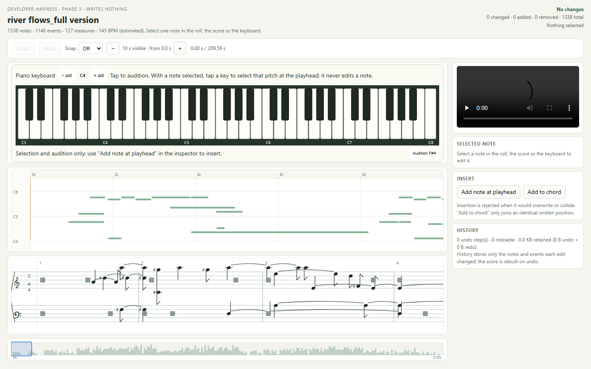
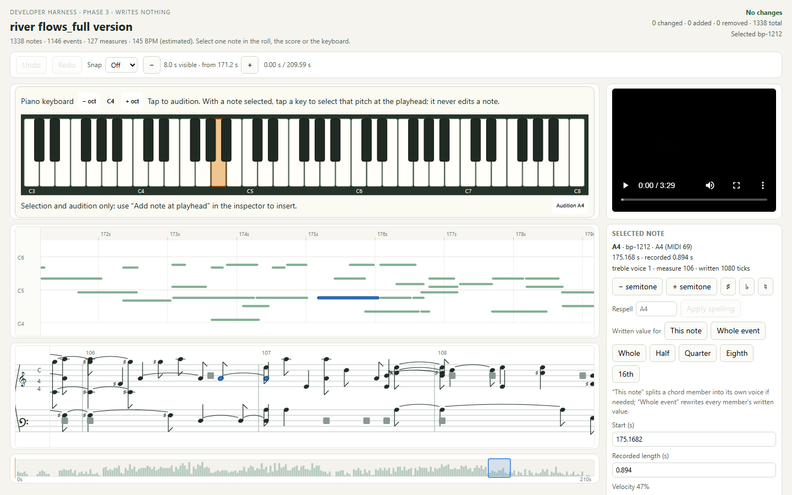

# Piano correction workspace — Phase 3 submission

Continuous correction layout, viewports and efficient rendering.

| | |
| --- | --- |
| Prepared | 13 November 2026 |
| Phase | **3 — Continuous correction layout and viewports** |
| Branch | `phase3/correction-layout` |
| Scope | Desktop and narrow-screen arrangement, ten-second roll window, zoom, continuous grand staff, whole-clip overview, culled rendering |
| Routes touched | **None.** The harness (`/workspace-harness.html?id=…`) only; review page, note forms, reviewed-lesson editor and API unchanged |
| Phase 4 | **Not started** |

---

## 0. What was built

| Deliverable | Where |
| --- | --- |
| Readable keyboard on top | Shared `KeyboardEditor`, now accepting a viewBox width/range so the harness shows five octaves (C3–C8) at desktop width and three on narrow screens |
| Ten-second scrollable piano roll with fixed pitch labels and a ruler | [`TimeRoll.tsx`](../../apps/web/src/music/workspace/TimeRoll.tsx) |
| Continuous horizontally scrollable grand staff with pinned clef/key/time context | [`ContinuousScore.tsx`](../../apps/web/src/music/workspace/ContinuousScore.tsx) |
| Whole-clip overview with a draggable visible-range window | [`ClipOverview.tsx`](../../apps/web/src/music/workspace/ClipOverview.tsx) |
| Shared viewport geometry (clamp, zoom anchor, reveal, ruler, measure widths, culling) | [`viewport.ts`](../../apps/web/src/music/workspace/viewport.ts) |
| Layout, zoom controls and the single video/document authority | [`PianoWorkspaceHarness.tsx`](../../apps/web/src/music/workspace/PianoWorkspaceHarness.tsx) |

The approved Phase 2 foundation is unchanged: one document, one occurrence selection, one patched history, the same commands, and the legacy reviewed editor left isolated.

---

## 1. Acceptance gate

| Criterion | Evidence |
| --- | --- |
| The actual long example is readable at default zoom | Opens at **10 s visible from 0 s**; 35 of 1,338 notes are mounted for the window; ruler ticks every 2 s; pitch labels C3–C8. See `captures/layout-desktop.png` |
| Sheet music is one continuous horizontal grand staff, not paginated or vertically wrapped | A single horizontally scrolling SVG strip with both staves, barlines, measure numbers and ties; **6 of 127 measures** mounted at 1440 px (4 at 390 px) |
| No horizontal page overflow at 390 px and desktop widths | `documentElement.scrollWidth === clientWidth` at **1440/1440** and **390/390**; each timeline scrolls inside its own container |
| Scroll/zoom does not mutate notes or seek playback inadvertently | After scrolling (10 s → from 29.8 s), zooming (10 → 8 s), zoom-out (16 s) and overview drags: status stays **“No changes · 0 changed · 1338 total”** and the playhead stays where it was |
| Selected notes can be found in both views, and active pitch/selection styles are distinguishable | Selecting `bp-1212` in the roll reveals the same occurrence in the score (`score_contains_selection: true`) and moves the window to it; selected notes are blue in both views, sounding keys orange |
| Header and toolbar do not cover editable content; no duplicate video/clock | Static header and one toolbar above the workspace; **one `<video>`** and one document authority (`videos: 1`) |

Clicking the roll ruler seeks (playhead 173.55 s inside the 171.2–179.2 s window) and still reports “No changes”; zooming with the playhead visible keeps it anchored (window 8 → 6.4 s, playhead unchanged).

---

## 2. How the viewports work

### 2.1 Roll (seconds)

`TimeRoll` maps source seconds to pixels for a `TimeWindow {start, span}` and scrolls a content element of width `duration × px/s`. The window is the source of truth: scrolling reports a new start, zoom changes the span, and the scroll position is re-synced whenever the window moves. Only notes intersecting the window plus a 30 % buffer are rendered (`data-culled-notes` records the count). The ruler seeks; notes select; nothing else on the surface acts.

### 2.2 Score (measures)

`layoutMeasures` gives each measure an engraved width from its note density (140–320 px). `ContinuousScore` renders only the measures intersecting the viewport plus a 280 px buffer, and the clef/key/time signature sit in a pinned 62 px column that does not scroll. Ties are drawn only when both endpoints are in the rendered range. Clicking a notehead selects its occurrence.

### 2.3 Overview

The overview computes per-bucket note density for the whole clip and draws the roll's visible range as a draggable window. Dragging or clicking the track pans the view and never seeks; arrow keys pan when the window has focus (`role="slider"`).

### 2.4 What this phase deliberately does not do

- No linked scrolling between roll and score, and **no score playhead** — both belong to Phase 4's shared alignment. The roll playhead is exact source seconds only.
- Selection reveal is one-way (selection moves the views, scrolling does not move the selection).
- No drag editing, no alignment authoring, no persistence, no change to the review workflow.
- Zoom is time-only; the roll pitch range still adapts to the clip's notes rather than offering an octave-range control.

---

## 3. Measured evidence

From `phase3-result.json` (Chromium 156, dev servers, real 209.594 s / 1,338-note draft):

| State | Window | Roll notes mounted | Score measures mounted | Page width | Playhead | Status |
| --- | --- | --- | --- | --- | --- | --- |
| Initial | 10 s from 0.0 | **35 / 1,338** | **6 / 127** | 1440 / 1440 | 0.00 s | No changes |
| After roll scroll | 10 s from 29.8 | 105 | 6 | 1440 / 1440 | 0.00 s | No changes |
| After zoom in | 8.0 s from 30.8 | 80 | 6 | 1440 / 1440 | 0.00 s | No changes |
| After overview click | 8.0 s from 175.0 | 66 | 6 | 1440 / 1440 | 0.00 s | No changes |
| After selecting `bp-1212` | 8.0 s from 171.2 | 76 | 6 (92 notes) | 1440 / 1440 | 0.00 s | 1 selected |
| After ruler seek | 8.0 s from 171.2 | 76 | 6 | 1440 / 1440 | **173.55 s** | No changes |
| After zoom on playhead | 6.4 s from 171.6 | 61 | 6 | 1440 / 1440 | 173.55 s | No changes |
| Zoomed out | 16 s from 168.9 | 140 | 6 | 1440 / 1440 | 173.55 s | No changes |
| Narrow screen | 16 s from 168.9 | 140 | 4 | **390 / 390** | 173.55 s | No changes |

One `<video>`, zero console errors in every state.






---

## 4. Tests and build

| Check | Command | Result |
| --- | --- | --- |
| Web (full) | `cd apps/web; npm test` | **399 passed, 0 failed** (6.2 s) — 388 previous + 11 viewport tests |
| Type check | `cd apps/web; node_modules\.bin\tsc --noEmit` | clean |
| Production build (incl. harness entry) | `cd apps/web; npm run build` | succeeds in 5.7 s (pre-existing chunk-size warning only) |
| Reviewer reproducers (Phase 2) | unchanged command layer | both still pass (covered by the 388) |

New tests ([`workspace-viewport.test.tsx`](../../apps/web/tests/workspace-viewport.test.tsx)) cover the window clamp, the ten-second default, zoom anchoring with and without a visible playhead, reveal margins, the ruler, measure-width bounds, culled measure ranges on a 127-measure score, “do not scroll when already visible”, and the tick/measure helpers.

---

## 5. Deviations and limitations

| Item | Status |
| --- | --- |
| No score playhead and no linked scrolling | Phase 4. The roll playhead is exact source seconds; the score shows measured scroll position only. |
| Roll pitch range adapts to the clip | No octave-range control yet; the shared keyboard provides octave shifts. |
| Overview labels sit at the strip's lower edge | Cosmetic; the strip is 46 px. |
| Narrow-screen keyboard is three octaves and small | Basic responsive structure only; touch target qualification is Phase 7. |
| Hints are hidden below 980 px height | Deliberate: keeps keyboard, roll, both staves and the overview visible together at 1440×900. |
| Legacy `NotationEditor` still owns its video and commands | Isolated by design; migration belongs with the Phase 7 workflow integration. |
| No drag gestures, alignment authoring or persistence | Phases 4–6. |

One environment note: repeated evidence runs hit the local API's login throttle (10 attempts / 15 min per account). The throttle rows for the disposable `form_ui_test` account were cleared locally to finish the capture; no product data was touched.

---

## 6. Review record

| Item | Value |
| --- | --- |
| Phase | 3 — Continuous correction layout and viewports |
| Accepted predecessor | `d461b16` (Phase 2 GO, see [acceptance record](piano-workspace-phase-02-acceptance.md)) |
| Submitted code | Branch `phase3/correction-layout` from `d461b16`; see the commit that adds this note |
| Developer summary | Ten-second roll viewport with fixed labels and ruler, culled rendering, continuous virtualised grand staff with pinned context, whole-clip overview, zoom, single video/document authority, narrow-screen stacking |
| Evidence | `phase3-result.json`, four captures, `logs/web-tests.txt`, `logs/web-build.txt`, `scripts/check-layout.py` |
| Deviations / limitations | §5 |
| Review decision | **NOT REVIEWED** |
| Next phase authorised | **None** — Phase 4 requires an explicit GO |

### Reproducing

```powershell
cd apps/web
npm test                    # 399 pass
node_modules\.bin\tsc --noEmit
npm run build

cd ..\..
# Dev servers running, then:
#   http://127.0.0.1:5173/workspace-harness.html?id=0df28929d427406cb86d9bb5e2dcd35b
# Scroll the roll, zoom with − / +, drag the overview window, click a note.
.\.venv-saas\Scripts\python.exe docs\qualification\piano-workspace-phase-03\scripts\check-layout.py
```

---

## 7. Scope statement

No playback or alignment behaviour, persistence, gesture editing, or production review replacement is included. The harness remains an isolated Vite entry; the ordinary review route and the reviewed-lesson editor are unchanged. Phase 4 has not started and awaits an explicit GO.
