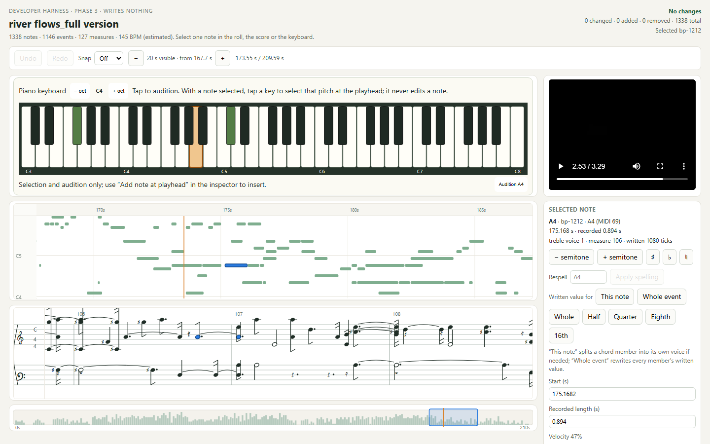
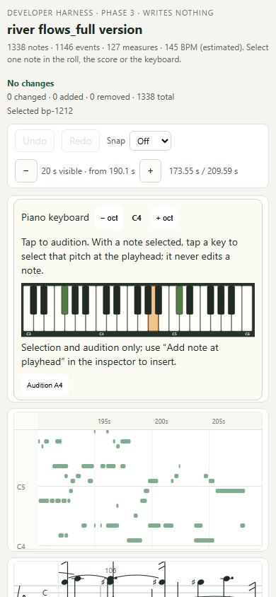

# Piano correction workspace — Phase 3 submission

Continuous correction layout, viewports and efficient rendering.

| | |
| --- | --- |
| Prepared | 13 November 2026 |
| Phase | **3 — Continuous correction layout and viewports** |
| Branch | `phase3/correction-layout` |
| Revision | **Correction submission after CHANGES REQUIRED** (R1–R4 plus the evidence-script notes) |
| Routes touched | **None.** The harness (`/workspace-harness.html?id=…`) only; review page, note forms, reviewed-lesson editor and API unchanged |
| Phase 4 | **Not started** |

---

## 0. Corrections in this revision

| Review item | Fix | Evidence |
| --- | --- | --- |
| **R1** Selection reveal pinned the time window and reversed manual navigation | Reveal is now an explicit **request** carrying a token. `TimeRoll` and `ContinuousScore` act once per token and read the current window through a ref, so panning, zooming, overview drags and edits never re-trigger it. The harness issues a token on selection change or when the inspector's **Reveal in views** button is pressed; clicking the already-selected note also re-requests it | Component tests: mount, rerender with a different window and identical token → zero `onWindowChange` calls; a new token moves the window once; browser evidence shows the pan persisting (window and `scrollLeft` change, playhead and “No changes” untouched) and Reveal bringing the note back |
| **R2** Responsive keyboard never measured after the async load | `useElementWidth` now returns a **callback ref** plus the element, so the observer attaches whenever the node mounts (including after loading) and detaches when it is replaced; it falls back to a window resize listener without `ResizeObserver` | Test: render a loading placeholder, then mount a 600 px host → measured width 600. Browser: desktop shows 36 white keys (five octaves) and the 390 px capture shows 22 (three octaves) |
| **R3** Wide pitch ranges were clipped and unreachable | The roll is a two-axis scrollable pitch canvas: rows fit the viewport when the range stays readable (≤ 28 rows), otherwise they use a 7 px row height and the canvas scrolls vertically. The fixed label column follows the vertical scroll, the ruler is sticky, the canvas opens around the clip's median pitch, and revealing a note scrolls vertically to its pitch as well as horizontally to its time | Test: A0–C8 (`MIDI 21`/`108`) yields a 385 px canvas inside a 168 px viewport with the low note inside the canvas; `pitchScrollTop` returns a positive offset for an off-screen row and leaves a visible row alone; reviewer reproducer passes |
| **R4** The continuous score lost written musical values | Every segment now renders its value: hollow heads for whole/half, filled for shorter values, no stem on a whole note, one to four flags for eighth/sixteenth/thirty-second/sixty-fourth, augmentation dots, and value-specific rest glyphs. Ledger lines, chords, ties, accidentals and selectability are preserved. A written note that maps several occurrences is **not** guessed: the click reports ambiguity through `onAmbiguous` and the harness explains it in the status line | Tests: per-value stem/flag/hollow assertions, dotted value renders a dot, rests render a glyph rather than a shared square, and a two-occurrence written note selects nothing and reports both ids; reviewer reproducer passes |

Non-blocking items:

- **Evidence script.** `check-layout.py` now takes `--base-url`/`--lesson`, writes to `<phase>/captures` and `<phase>/phase3-result.json`, reuses a saved browser session to avoid repeated logins, and **exits nonzero** when any acceptance condition fails. It asserts the ten-second default, culling, one video, no page overflow, playhead and dirty-state stability, pan persistence after selection, explicit reveal, ruler seek, and the narrow keybed.
- **Short clips.** `spanBounds` collapses the minimum span to the clip length, so a 1.2 s clip shows a 1.2 s window instead of a 2 s one; boundary test added.
- **Keyboard defaults.** The shared `KeyboardEditor` keeps its existing three-octave default; the harness opts into five octaves at desktop width.

---

## 1. Acceptance gate

| Criterion | Evidence |
| --- | --- |
| The actual long example is readable at default zoom | Opens at **10 s visible**, 35 of 1,338 notes mounted, ruler every 2 s, pitch canvas centred on the median and vertically scrollable (385 px canvas in a 168 px viewport) |
| Sheet music is one continuous horizontal grand staff, not paginated or wrapped | One scrolling SVG strip; **6 of 127 measures** mounted at 1440 px, 4 at 390 px; each written value rendered distinctly with a pinned clef/key/time column |
| No horizontal page overflow at 390 px and desktop widths | **1440/1440** and **390/390** `scrollWidth === clientWidth` |
| Scroll/zoom does not mutate notes or seek playback inadvertently | After roll scroll, zoom in, overview pan, panning with a selection, and ruler seek: playhead only changes on the explicit ruler click, and the status stays “No changes · 0 changed · 1338 total” throughout |
| Selected notes can be found in both views, and active pitch/selection styles are distinguishable | Selecting `bp-1212` reveals the same occurrence in the score (`score_contains_selection: true`) and moves the window; blue in the roll and on the score notehead, orange on the keyboard, green for sounding keys |
| Header and toolbar do not cover editable content; no duplicate video/clock | Static header and one toolbar; **one `<video>`**; one document authority |

---

## 2. How the viewports work

### 2.1 Roll (seconds × pitch)

`TimeRoll` maps a `TimeWindow {start, span}` to pixels and scrolls a content element of width `duration × px/s`. The window is the source of truth; scrolling reports a new start, zoom changes the span, and the scroll position is re-synced whenever the window moves. Pitch rows fit the viewport when the clip range stays readable and otherwise use a 7 px row in a vertically scrollable canvas whose fixed label column follows the scroll. Revealing is keyed on a request token and moves both axes; nothing else on the surface acts except ruler-seek and note-select.

### 2.2 Score (measures × written values)

`layoutMeasures` gives each measure an engraved width from its note density (140–320 px). Only measures intersecting the viewport plus a 280 px buffer are rendered, with the clef/key/time signature pinned in a 62 px column. Noteheads, stems, flags, dots and rests follow the segment's written value. Ties are drawn only when both endpoints are rendered.

### 2.3 Overview

Per-bucket density for the whole clip with a draggable visible-range window. Dragging or clicking pans both views and never seeks; arrow keys pan when the window has focus.

### 2.4 Deliberately not in this phase

- No linked scrolling and **no score playhead** — Phase 4's shared alignment.
- No drag editing, alignment authoring, persistence or review-route replacement.
- Zoom is time-only; the pitch axis scrolls rather than zooming.

---

## 3. Measured evidence

From `phase3-result.json` (Chromium 156, real 209.594 s / 1,338-note draft; the capture script asserts these):

| State | Window | Roll notes | Measures | Pitch canvas | White keys | Page | Playhead | Status |
| --- | --- | --- | --- | --- | --- | --- | --- | --- |
| Initial | 10 s from 0.0 | 35 / 1,338 | 6 / 127 | 385 px | 36 | 1440/1440 | 0.00 | No changes |
| After roll scroll | from 29.8 | 105 | 6 | 385 | 36 | 1440/1440 | 0.00 | No changes |
| After zoom in | 8.0 s | 80 | 6 | 385 | 36 | 1440/1440 | 0.00 | No changes |
| After overview pan | from 175.0 | 66 | 6 | 385 | 36 | 1440/1440 | 0.00 | No changes |
| After selection | from 171.4 | 69 | 6 | 385 | 36 | 1440/1440 | 0.00 | 1 selected |
| **After panning with selection** | from 183.7 | 55 | 6 | 385 | 36 | 1440/1440 | 0.00 | No changes |
| After **Reveal in views** | back to 171.4 | 76 | 6 | 385 | 36 | 1440/1440 | 0.00 | No changes |
| After ruler seek | 8.0 s | 76 | 6 | 385 | 36 | 1440/1440 | **173.55 s** | No changes |
| Zoomed out | 19.5 s | 185 | 6 | 385 | 36 | 1440/1440 | 173.55 | No changes |
| Narrow screen | 19.5 s | 88 | 4 | 385 | **22** | **390/390** | 173.55 | No changes |

Zero console errors, zero failed assertions.






---

## 4. Tests and build

| Check | Command | Result |
| --- | --- | --- |
| Web (full) | `cd apps/web; npm test` | **410 passed, 0 failed** — 399 previous + 10 surface tests + 1 short-clip viewport test |
| Type check | `cd apps/web; node_modules\.bin\tsc --noEmit` | clean |
| Production build | `cd apps/web; npm run build` | succeeds, pre-existing chunk-size warning only |
| Reviewer reproducer | `node --import ./apps/web/node_modules/tsx/dist/loader.mjs docs/qualification/piano-workspace-phase-03-review-repro.ts` | **4/4 PASS** (was 0/4) |
| Capture script | `python docs/qualification/piano-workspace-phase-03/scripts/check-layout.py` | exit 0, all acceptance assertions pass |

New component tests ([`workspace-surfaces.test.tsx`](../../apps/web/tests/workspace-surfaces.test.tsx)) run the actual React surfaces in JSDOM and lock the four defects: pan-after-selection, late-mount width measurement, 88-key canvas geometry and pitch reveal, and per-value notation with the ambiguity safeguard.

---

## 5. Deviations and limitations

| Item | Status |
| --- | --- |
| No score playhead and no linked scrolling | Phase 4. |
| Roll pitch axis scrolls rather than zooms | A defined scrollable range with a clear mechanism; every supported note is reachable and reveal moves both axes. |
| Dense score remains visually simple | Correct values, ties, ledgers and accidentals; publication engraving and pagination are Phase 8. |
| Narrow-screen keybed is small (three octaves) | Basic responsive structure; touch-target qualification is Phase 7. |
| Overview labels sit at the strip's lower edge | Cosmetic; strip is 46 px. |
| Hints hidden below 980 px height | Keeps keyboard, roll, both staves and overview visible together at 1440×900. |
| Legacy `NotationEditor` still owns its video and commands | Isolated by design; migration belongs with Phase 7. |

---

## 6. Review record

| Item | Value |
| --- | --- |
| Phase | 3 — Continuous correction layout and viewports |
| First submission | `86b3d3a` — CHANGES REQUIRED ([review](piano-workspace-phase-03-review.md), [reproducer](piano-workspace-phase-03-review-repro.ts)) |
| Correction | R1–R4 plus evidence-script assertions, output paths, session reuse and the short-clip policy |
| Developer summary | Reveal is an explicit request; width measurement survives async mounts; the roll is a scrollable pitch canvas with pitch-aware reveal; the score renders written values and refuses to guess ambiguous occurrences |
| Evidence | `phase3-result.json`, four captures, `logs/web-tests.txt`, `logs/web-build.txt`, `logs/reviewer-repro.txt`, `scripts/check-layout.py` |
| Deviations / limitations | §5 |
| Review decision | **NOT REVIEWED** |
| Next phase authorised | **None** — Phase 4 requires an explicit GO |

### Reproducing

```powershell
cd apps/web
npm test                    # 410 pass
node_modules\.bin\tsc --noEmit
npm run build

cd ..\..
& 'C:/Program Files/nodejs/node.exe' --import ./apps/web/node_modules/tsx/dist/loader.mjs docs/qualification/piano-workspace-phase-03-review-repro.ts
.\.venv-saas\Scripts\python.exe docs\qualification\piano-workspace-phase-03\scripts\check-layout.py

# Harness (dev servers running):
#   http://127.0.0.1:5173/workspace-harness.html?id=0df28929d427406cb86d9bb5e2dcd35b
```

---

## 7. Scope statement

No playback or alignment behaviour, persistence, gesture editing or production review replacement is included. The harness remains an isolated Vite entry; the ordinary review route and the reviewed-lesson editor are unchanged. Phase 4 has not started and awaits an explicit GO.
