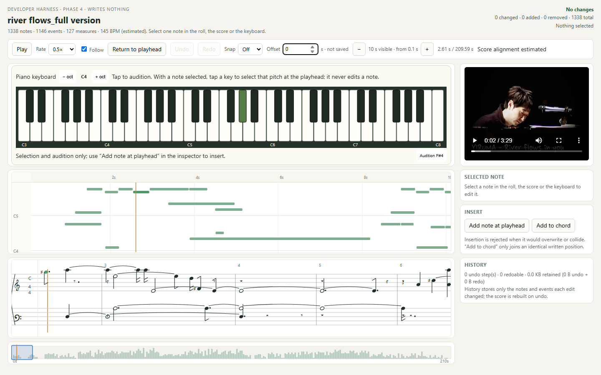
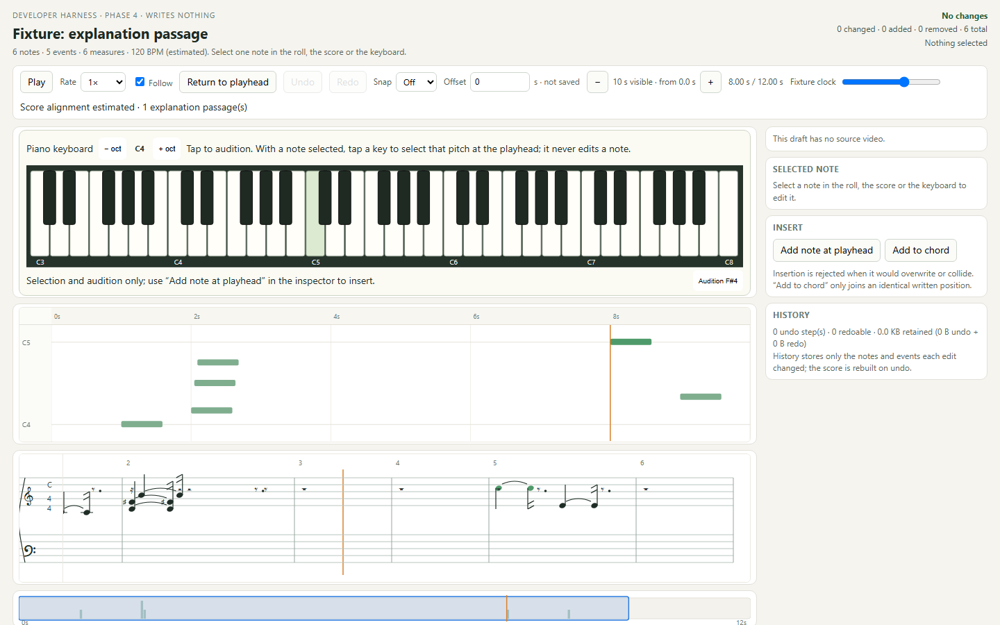

# Piano correction workspace — Phase 4 submission

One source clock, a shared time↔score map, linked navigation and follow playback.

| | |
| --- | --- |
| Prepared | 13 November 2026 |
| Phase | **4 — Shared playback, linked navigation and musical alignment** |
| Branch | `phase4/shared-playback` |
| Scope | Score playhead, alignment passages and anchors, exact occurrence activation, inverse seeking, linked scroll, Follow / manual suspension / Return to playhead, offset applied once |
| Routes touched | **None.** The harness only; review page, note forms, reviewed-lesson editor and API unchanged |
| Phase 5 | **Not started** |

---

---

## 0.6 Second follow-up — supported Piano flow and precise timing claims

### Supported Piano flow (automated, in the shared suite)

`apps/web/tests/workspace-piano-integration.test.tsx` runs in `npm test` and renders the actual harness with
controlled media doubles (currentTime, duration, readyState, paused, muted, volume, playbackRate, play/pause
events), a bounded frame scheduler and the **real** preview hook and source controller.

1. **Pending verification**: the preview fetch is held open; Piano is disabled, `audio.src` is `null`, and the
   UI says it is verifying. When the bytes resolve with a matching SHA-256, the blob URL is exposed and Piano
   enables.
2. **Controller integration**: with a 0.5 s offset and Piano selected, the video is muted, Piano maps 5 s → 4.5 s,
   play/pause reach the Piano element, a seek to 10 s maps to 9.5 s, changing the video rate to 0.5 reaches the
   Piano element, and a new 1.0 s offset remaps 10 s → 9 s. The video remains the only transport.
3. **Original restores**: selecting Original stops Piano and unmutes the source. A rejected `play()` makes the
   controller fail; the harness visibly falls back to Original (aria-pressed) with source audio restored.
4. **Cleanup**: unmount revokes the verified blob URL through the preview hook, restores the source mute state,
   and leaves no scheduled frame callbacks.

Two tests, both in the suite; the file terminates normally and fails on unmet assertions. Total suite **433
passing**.

### Timing qualification — corrected claims

| Claim | Evidence |
| --- | --- |
| Stepped fixture, settled activation | 12 ms attacks at 2.000/2.012/2.024, sampled after two rendered frames — labelled **stepped** evidence in `stepped_frames` |
| Positive offset | +0.5 s: first attack at 2.504, second at 2.516 |
| Negative offset | −0.5 s: first attack at 1.504, second at 1.516 |
| Release boundary | at exactly 2.500 s the first note is gone while the later two still sound |
| Nonzero viewport in the controlled scenario | window starts at **1.3 s**, not zero |
| Live progressing clock | rate 1 worst lag **14.7 ms**, tick within **17 ticks**; rate 0.5 advances **0.507 s** per wall second; seek agrees with the cursor |
| Occurrence identities | sets compared across roll, score and keyboard at every step (not raw counts) |

The stepped fixture is settled-per-step evidence and is **not** presented as a progressing-frame-clock test;
that role belongs to the live rate/seek samples above.

---

## 0.7 First follow-up correction (superseded)


| Item | Resolution | Evidence |
| --- | --- | --- |
| **F1** Piano bypassed asset verification | The harness now uses the existing `usePianoPreviewAsset` hook: the preview bytes are fetched, their length and SHA-256 checked, and only a verified asset yields a blob URL. Piano is disabled while pending or failed, no `src` is exposed, and the failure message keeps Original audio. | Probe: a three-byte preview with a wrong hash leaves Piano disabled, `src=null`, with the honest message; a fetch of the preview bytes is observed. |
| **F2** Original-only playback did not stop audition | The audition-stop effect now depends on the harness's own source-derived `playing` state, not on the optional Piano controller, so it fires with or without a preview. Mode change and unmount also stop audition. | Probe: source-video draft with no preview; audition then `video.play()` produces `NotationAudio.stop()` calls. |
| **F3** Timing evidence corrected | New `?demo=frames` fixture with attacks at **2.000 / 2.012 / 2.024 s** (12 ms apart), stepped with a 1 ms clock granularity and read after two rendered frames. Occurrence identities are compared as sets across roll (`data-occurrence`, `data-pitch`), score (`data-occurrences`) and keyboard (`data-pitch`) rather than by total counts. Measures now include rate 1, rate 0.5, a seek at a nonzero viewport, and the one-displayed-frame target (16.7 ms). | Measured: rate-1 worst cursor lag **12.3 ms** (≤ one frame), score tick within **14 ticks**, rate-0.5 advances **0.508 s** of media per wall second with the cursor in step, seek agrees, and the 12 ms fixture lights exactly one, two and three occurrences at 2.004 / 2.016 / 2.028 s with identical identity sets in all three views. |

Probe (`docs/qualification/piano-workspace-phase-04/scripts/workspace-audio.probe.tsx`, run from `apps/web`
with `npx tsx --test tests/workspace-audio.probe.tsx`): **2/2 pass**, exit 0. It renders the actual harness
with a tracked synthetic draft, mocked media events and audition methods, and performs no service calls or
writes. It is kept out of the shared suite because jsdom keeps media handles open; it exits explicitly.

**Limitation recorded at that commit (now resolved):** the valid, verified preview path was not automated
there; §0.6 adds the actual-workspace integration test for the successful path, controller behaviour, failure
fallback and cleanup.

431 web tests passed at that commit; `tsc` clean; timing script exited 0; audio probe exited 0.

---

## 0.5 Previous correction round (superseded)


The earlier status block below is superseded. Commits `54813d0`, `d88017d`, `d9b4733`, `eb194bb` and
the current commit address R1–R6 and the trailing-hold boundary.

| Item | Resolution | Evidence |
| --- | --- | --- |
| **R1** keyboard ignored the offset | Keyboard highlights and key selection use the same `occurrenceIntervals` as roll and score | Reviewer reproducer; `?demo=arpeggio` at +0.5 s / 2.25 s shows 0 roll, 0 score, 0 keys |
| **R2** speech time compressed in the map but not the score | `scoreClock` defines one score-time domain; `buildNotation` accepts `scoreSeconds`/`scoreDuration`, so a note played at 8 s is engraved at tick 4800 where the cursor maps it | Engraving test; browser: post-explanation notehead is **0 px** from the cursor at 8 s and its written tick maps back to 8 s |
| **R3** validation, inverse and ruler bounds | Map must tile the clip and stay continuous at joins; `spansProblem` reports bad spans; inverse scans before clamping; trailing hold returns the hold start; ruler clamps before/after content | 6 new tests + reviewer reproducer 5/5 |
| **R4** anchor authoring, validation, undo/redo | `applyAnchors` applies a point list, keeps the last valid map and reports the first failure; harness panel authors a point at the stored source position, previews the current mapping, undoes/redoes, resets and removes points without dirtying the document; anchors survive unrelated edits | Anchor tests; browser flow applied → undo → redo → seek with `No changes` preserved |
| **R5** source player not connected | Harness loads the draft's `piano_preview` and identity, renders the audio element and drives `usePianoSourcePlayer` with the one video clock and current offset; Original/Piano toggle; Piano disabled with an honest message when no verified preview exists; audition stops on playback or mode change | Gating test; source-player mapping tests already cover the controller |
| **R6** frame-rate visuals vs inspector | `clock.ts` store mirrors the video every frame; TimeRoll, ContinuousScore and LiveKeyboard subscribe; inspector state updates at ~4 Hz; measured lag ≤ 1.5 frames | Worst roll lag **14 ms**, score tick within 16 ticks (~14 ms), nonzero viewport and offset cases, short-note transitions at their exact times |

Trailing hold specifically: with playing 0–4 s and explanation 4–10 s, the held tick 3840 now returns
**4 s** (`tickToSeconds` scans holds before clamping), while a tick beyond the score domain still clamps
to 10 s.

Current verified state: **431 web tests pass**, `tsc --noEmit` clean, reviewer reproducer **5/5**, frame
and anchor browser checks exit 0. Phase 5 remains blocked pending review.

---

## 0.3 Earlier partial-correction status (superseded)


**Do not treat this commit as the Phase 4 correction submission.** The reviewer's R1–R6 require six
corrections; two are complete here and four are not started. This commit is pushed so the verified
work is reviewable and the branch is not silently half-edited.

| Item | Status |
| --- | --- |
| **R1** Keyboard ignored the sync offset | **Fixed.** Keyboard highlights and key-selection candidates now come from the same `occurrenceIntervals` used by the roll and score. Verified by the reviewer reproducer (`offset activation agrees across keyboard, roll and score`) and by the harness at +0.5 s / 2.25 s. |
| **R3** Alignment validation accepted holes and jumps; the inverse could seek forwards | **Fixed.** `alignmentProblem` now requires the map to tile the clip exactly (head, tail, no holes or overlaps), validates kind/mode/basis and whole ticks, and requires score continuity at every join; a silent jump is reported. `tickToSeconds` clamps to the score domain (negative → start, past the end → clip end) while keeping hold-start priority. `spansProblem` reports reversed/overlapping authored spans, and `alignmentFromSpans` falls back to a valid estimated map instead of returning an invalid list. `tickAtX` clamps before the first measure and after the last. Covered by four new tests and all five reviewer reproducer checks. |
| **R2** Explanation time compressed in the map but not in the engraved score | **Not done.** The score is still built from absolute recording seconds, so a post-explanation note is engraved at its source position while the cursor maps to score time. This is the largest remaining defect. |
| **R4** Anchor authoring flow | **Not done.** No UI, no authored-map history, no annotated rubato evidence. |
| **R5** Existing source player not connected | **Not done.** The harness still uses only the video element; `usePianoSourcePlayer`, the verified preview asset and the Original/Piano modes are not wired. The earlier claim that the controller “owns audio mapping” in this harness was **incorrect** and is withdrawn here. |
| **R6** Visual-clock timing | **Not done.** The ~20 fps paint throttle remains; no frame-level measurement against the current video timestamp exists. |
| Fixture wording | Corrected: the audit found **89 real chord events with staggered recorded onsets (up to 92.8 ms)**, so “the real recording has no arpeggio” was wrong. The synthetic fixture is for controlled ground truth; real staggered chords remain in qualification, with arpeggiation versus decoder jitter unresolved. |

Current verified state: **425 web tests pass**, `tsc --noEmit` clean, reviewer reproducer **5/5 PASS**.
R2, R4, R5 and R6 are outstanding and were not attempted in this commit.

---

## 0.1 Original submission contents (unchanged below)


| Deliverable | Where |
| --- | --- |
| Alignment map: timed and held passages, anchors, validation | [`packages/music-notation/alignment.ts`](../../packages/music-notation/alignment.ts) |
| Score playhead and ruler-to-tick inverse | [`ContinuousScore.tsx`](../../apps/web/src/music/workspace/ContinuousScore.tsx) + `xForTick`/`tickAtX` in [`viewport.ts`](../../apps/web/src/music/workspace/viewport.ts) |
| Exact activation lighting in roll, score and keyboard | `occurrenceIntervals` / `activeOccurrenceIds`, consumed by the surfaces |
| One transport over the existing video clock | Harness Play/Pause and rate controls driving the same `<video>`; `usePianoSourcePlayer` still owns audio mapping |
| Linked navigation with a single origin | Roll window ↔ score scroll by musical position, both keyed on request tokens |
| Follow playback, manual suspension, Return to playhead | Harness effects and toolbar |
| Offset applied once | `effectiveSecondsToTick` / `tickToEffectiveSeconds`; notes drawn at `onset + offset` |
| Fixtures for the cases the recording lacks | `?demo=explanation` and `?demo=arpeggio`, plus a fixture clock |

---

## 1. Acceptance gate

| Criterion | Evidence |
| --- | --- |
| One source clock; no second transport | The harness has a single `<video>` (`videos: 1`) and its Play/Pause and rate controls drive it; the playhead state is derived from `video.currentTime` (repainted at ~20 fps, not a separate clock) |
| Play/pause/seek/rate update both views consistently | Playing advances the clock and both cursed lines move; the score ruler click seeks the video (time change > 0.2 s); rate 0.5 applied to the video |
| Both cursors represent the same musical moment | At 1.538 s the roll-derived position maps to tick **1784**, and the score cursor reports **1784** (`cursor_agreement`, tolerance 12 ticks) |
| Clicking a note seeks to the actual effective onset | `select()` now pauses, selects, seeks to `onset + offset` and reveals — never a quantised position |
| Scrolling does not seek or edit; scrubbing does | Panning the roll moved the window and the score by musical position with `video_time` unchanged; the score ruler click changed `video_time` |
| Manual scroll disables Follow; no oscillation | Pan sets `follow: false`; the score followed once (`score_scroll` changed) and no scroll events looped; Return re-enabled Follow |
| Active notes light at exact recorded times | Arpeggio fixture: **0** active at 1.9 s, **1** at 2.01 s, **2** at 2.05 s, **3** at 2.1 s — the three attacks share one engraved chord but light individually |
| Explanation passages hold the cursor honestly | Fixture: the score cursor stays at tick **3840** from 4.4 to 6.9 s while the clock advances, then resumes to **4800** at 8 s |
| Offset applied once, in both directions | Offset 0.5 s moves the mapped tick by exactly **580** ticks at 1160 ticks/s (3027 → 2447); dragging the offset back restores it; note drawing shifts by the same half second |
| Anchors cannot reverse time or score order | Unit tests: an anchor splitting at (4 s, 4000 ticks) is accepted and re-slopes both stretches; edge ticks, out-of-clip times and anchors inside a held passage are rejected |
| Follow keeps the cursor visible without fighting the user | Edge-based scroll resumes only while playing with Follow on; any manual pan turns it off |





---

## 2. The alignment model

```ts
type TimedPassage = {kind:'timed'; source_seconds:[number,number]; ticks:[number,number]};
type HeldPassage  = {kind:'held';  source_seconds:[number,number]; tick:number};
type Alignment = {alignment_version:1; mode:'estimated'|'anchored'; basis:'tempo'|'passages'; passages:...};
```

- **Estimated vs anchored** is explicit in the data and in the toolbar label (“Score alignment estimated”).
- **Spans build passages sequentially:** a playing span advances the score by its own duration; an explanation span (or an uncovered gap) holds the cursor at the tick reached, and the next playing span resumes from that tick rather than jumping ahead or inventing beats.
- **The hold policy is fixed and tested:** a tick that exists inside a hold also exists at the end of the preceding stretch; the inverse returns the **start** of the hold.
- **Anchors** are authored points strictly inside a timed stretch; they split it and set `mode: 'anchored'`. Anchors at a stretch edge, outside the clip, or inside a hold are rejected with a message.
- **The offset is a boundary conversion**, never stored in a passage: `effectiveToTick = secondsToTick(effective − offset)` and `tickToEffective = tickToSeconds(tick) + offset`.
- **Activation uses the recorded intervals** (`onset + offset` to `onset + offset + recorded length`), so an arpeggiated chord lights one note at a time even though the score engraves one chord.

---

## 3. Navigation and Follow

- The roll window and the score scroll are separate containers; each reports **user** movement with an origin tag and accepts **request** targets keyed on a token, so a programmatic scroll cannot echo back.
- Rolling the roll computes the tick at the window's left edge and scrolls the score to it; scrolling the score computes the tick at its left edge and moves the roll. Neither touches the video clock or the document.
- Follow playback is edge-based: while playing, if the cursor leaves the comfortable band the window scrolls to keep it at a quarter of the viewport; the score follows the mapped tick. Any manual pan disables Follow and the toolbar shows the checkbox state. **Return to playhead** re-centres both views and re-enables Follow without starting playback.
- Painting is throttled to ~20 fps so the inspector and forms do not re-render at frame rate; the source video remains the only clock.

---

## 4. Tests

| Check | Command | Result |
| --- | --- | --- |
| Web (full) | `cd apps/web; npm test` | **421 passed, 0 failed** — 410 previous + 11 alignment/activation tests |
| Type check | `cd apps/web; node_modules\.bin\tsc --noEmit` | clean |
| Production build | `cd apps/web; npm run build` | succeeds (pre-existing chunk-size warning) |
| Browser evidence | `python docs/qualification/piano-workspace-phase-04/scripts/check-playback.py` | exit 0, all assertions pass |

New tests ([`workspace-alignment.test.tsx`](../../apps/web/tests/workspace-alignment.test.tsx)) cover: linear estimation; playing/explanation passage construction; the held-tick inverse; offset applied once both ways; anchor acceptance and both rejection families; exact occurrence intervals and activation (including two attacks 12 ms apart); gap holds; and structural validation of a malformed alignment.

---

## 5. Deviations and limitations

| Item | Status |
| --- | --- |
| Anchors are derivable and tested but have no authoring UI yet | The plan's “Align beat to video” flow is a Phase 6/7 interaction; the contract and command exist. |
| The harness clock is painted at ~20 fps | Deliberate throttle; a cursor layer outside React is a later performance task if 20 fps reads poorly on device. |
| Follow uses an edge-based rule, not frame-locked sticky centring | Matches the plan's “jump to 25 %” allowance; no oscillation at boundaries because only out-of-band positions move the window. |
| No persistence of alignment or offset | Phase 5. The offset control is labelled “not saved”. |
| Fixtures are synthetic | The real recording has no explanation passage and no arpeggio, so `?demo=…` supplies both; the real clip covers normal playback, seeking, rate, linking and offset. |
| Legacy `NotationEditor` still owns its video | Isolated by design; migration is Phase 7. |

---

## 6. Review record

| Item | Value |
| --- | --- |
| Phase | 4 — Shared playback, linked navigation and musical alignment |
| Accepted predecessor | `e240588` (Phase 3 GO) |
| Submitted code | Branch `phase4/shared-playback` from `e240588`; see the commit that adds this note |
| Developer summary | Alignment passages/anchors, score cursor, exact activation, inverse ruler seeking, linked scroll with request tokens, Follow with manual suspension and Return, offset once, transport over the single video |
| Evidence | `phase4-result.json`, two captures, `logs/web-tests.txt`, `logs/web-build.txt`, `scripts/check-playback.py` |
| Deviations / limitations | §5 |
| Review decision | **NOT REVIEWED** |
| Next phase authorised | **None** — Phase 5 requires an explicit GO |

### Reproducing

```powershell
cd apps/web
npm test                    # 421 pass
node_modules\.bin\tsc --noEmit
npm run build

cd ..\..
.\.venv-saas\Scripts\python.exe docs\qualification\piano-workspace-phase-04\scripts\check-playback.py

# Harness (dev servers running):
#   http://127.0.0.1:5173/workspace-harness.html?id=0df28929d427406cb86d9bb5e2dcd35b
#   http://127.0.0.1:5173/workspace-harness.html?demo=explanation
#   http://127.0.0.1:5173/workspace-harness.html?demo=arpeggio
```

---

## 7. Scope statement

No persistence, recovery, gesture editing, formatted score or production review replacement is included. The harness keeps its feature boundary, the ordinary review route and reviewed-lesson editor are unchanged, and the legacy editor's video remains isolated. Phase 5 has not started and awaits an explicit GO.
